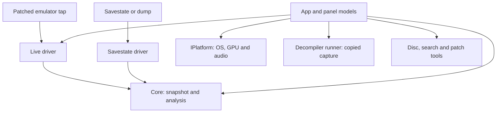

# Architecture and ownership

Inspected revision: `ff6a3b1fb1c54e4c0344613094ea65292b0023c2`.
Verified source map; reasons explicitly attributed to the existing design are design rationale.

## Components and boundaries

The arrows show use/data transfer, not necessarily synchronous calls. The live driver owns
transport workers, and the decompiler owns a separate worker; neither directly draws UI.

| Boundary | Contract and ownership | Where to extend |
|---|---|---|
| Seam A: source to core | [SeDataSource.h](../../include/saturnexplorer/SeDataSource.h), `se_data_source`: capability-gated function pointers and source `user` state | [StateSources](Systems/StateSources.md) for formats, transport and emulator exports |
| Seam B: core to host | [SeHost.h](../../include/saturnexplorer/SeHost.h), [HostAbi.cpp](../../Core/src/HostAbi.cpp): opaque context, C ABI queries and `se_result` | [Graphics](Systems/Graphics.md) for parsing, rendering and derived state |
| Seam C: frontend to OS | [IPlatform.h](../../FrontEnd/src/Platform/IPlatform.h), `sfe::IPlatform`: texture, dialog, launch, filesystem, audio, HTTPS and frame loop operations | [Frontend](Systems/Frontend.md) for platform parity |
| Captured code to engine | [DecompilerRunner.h](../../FrontEnd/src/Decompiler/DecompilerRunner.h), [MemorySnapshot.h](../../FrontEnd/src/Decompiler/MemorySnapshot.h): owned capture and worker request/result | [Decompiler](Systems/Decompiler.md) for analysis and pseudocode UI |
| Debug models to emulator | [App.cpp](../../FrontEnd/src/App.cpp): `SyncBreakpointsToLive`, `SyncTracepointsToLive`, `StepInto`, `Continue`; live C APIs | [Debugger](Systems/Debugger.md) for policy, [StateSources](Systems/StateSources.md) for protocol |

The C ABI boundary keeps UI/OS types out of the reusable engine and makes driver/host adapters
replaceable (rationale: [existing architecture](../../ARCHITECTURE.md), sections 2–5). The actual
frontend directly uses live-driver control APIs as well as Seam B: the generic core is not the
owner of stepping policy, file search, patch projects or recording.

## Core state and rendering

`Context` in [Context.h](../../Core/src/Context.h) owns a `HardwareSnapshot`, parsed commands,
derived scene, reference indexes and caches. `se_begin_frame` enters `Context::BeginFrame`,
which captures source memory then derives graphics. Panel queries read that captured state.
Source changes and local writes must invalidate affected derivations and identities; do not
use a context pointer or emulator frame number alone as a freshness key.

Core software-renders both the 2D composite and the exploded 3D view. `App::DrawWorldView →
se_render_3d → Context::Render3D → Vdp1Rasterizer::Render3D` produces RGBA, then the platform
uploads a texture. The older architecture text describing GPU rendering of world geometry is
not the bundled frontend's actual path. Geometry remains available through the host API.

## Application orchestration and lifetime

`App` owns frontend source/context handles, panel models, render/selection state, pending
commands and workers. Source creation is centralized through `CreateContextFromSource` in
[App.cpp](../../FrontEnd/src/App.cpp). Once created, a context owns the source destruction
callback; App retains a borrowed function-table copy for controls. `CloseData` destroys the
context and zeroes that borrowed copy. See [StateSources](Systems/StateSources.md) for failure
ownership and driver release details.

Platform entry points initialize their backend/ImGui, then `App::Initialize`. App loads settings,
session annotations and function names; starts its optional decompiler; and later auto-connects
or opens a source. Native loops drive event pumping and UI frame construction. Shutdown stops
search, joins the decompiler, persists preferences and annotations, closes data, then shuts down
the platform. Read [Frontend](Systems/Frontend.md) for update-worker lifetime qualifications.

## Concurrency and snapshot boundaries

| Execution context | Owns/does | Transfer rule |
|---|---|---|
| UI thread | App, panels, core context reads/derivation, command policy | Select displayed context before panel reads and exports |
| Live transport thread | socket/pipe messages, newest remote snapshot, control queues | `begin_capture` pins one snapshot for the entire core read sequence |
| Live connect worker | potentially blocking connection attempt | UI polls completion and adopts or disposes the result |
| Decompiler runner | engine lifecycle and analysis | owns copied immutable request memory; UI validates result against current view |
| Search workers | file/RAM scans | own request input; cancellation and completion are routed back to UI |
| Recorder worker | compresses raw recorded hardware and publishes ring frames under lock; UI attaches state blocks | recorder serializes shared work; identity is a frame/session concept, not ring index |
| Update check worker | blocking platform HTTPS | mutex-protected shared result; platform lifetime contract requires care |

These are subsystem-specific synchronization contracts, not permission to use arbitrary core
or ImGui objects concurrently. See the subsystem documents for cancellation, joining, restore
acknowledgements and stale-answer rejection.

## Developer routing

For paused-variable display, start at [Decompiler](Systems/Decompiler.md), then
[Debugger](Systems/Debugger.md) and [MemoryAndHistory](Systems/MemoryAndHistory.md). Existing
watch-expression support does not by itself provide mappings from optimized pseudocode locals
to runtime storage. For a new memory source, start at Seam A; for a new host OS, start at Seam C.
For a new texture/disc workflow, keep core decoding separate from frontend search and accepted
file-location policy. AI investigation contracts are compiled/tested but currently have no App
call sites: [AIInvestigation](Systems/AIInvestigation.md).
