# SH-2 pseudocode and embedded decompiler

Inspected revision: `ff6a3b1fb1c54e4c0344613094ea65292b0023c2` (2026-10-20).
Captured-inspection sections rechecked against `codex/decompiler-variable-inspection` (2026-10-20).
The panel's status/trust drawing, Decompile-as-a-request and Copy marks rechecked against `5428fe6` plus the area 8 fixer branch (2026-10-30).
Unless labelled otherwise, behavior below is verified from the cited implementation.

## Purpose and responsibilities

The desktop **SH-2 Pseudocode** panel decompiles captured Saturn code into navigable,
syntax-colored pseudocode. It supports both SH-2 CPUs, follow-PC and explicit entries,
function-start corrections, function names, assembly-note overlays, optional BIOS bytes,
hardware-register names and cautions, volatile-memory ranges, and uncertainty/staleness
indicators. It is an analysis of a captured image, not an execution of the game.

The integration lives in the frontend, outside the portable rendering core. Ghidra owns
SLEIGH translation, SSA/data-flow analysis, structuring, and C printing. SE supplies the
captured load image, Saturn hardware semantics/configuration, function hints, conservative
signature lending, output/source mapping, asynchronous scheduling, and UI validity policy.
See [`Sh2Decompiler::DecompileInto`](../../../FrontEnd/src/Decompiler/Sh2Decompiler.cpp)
and [`SaturnArchitecture::Initialise`](../../../FrontEnd/src/Decompiler/SaturnArchitecture.cpp).

## Source locations and important types

| Responsibility | Source and important symbols |
|---|---|
| App integration and capture identity | [`App.cpp`](../../../FrontEnd/src/App.cpp): `BuildDecompilerView`, `UpdateDecompiler`, `LoadBiosImage`, `ResetSessionDebugState` |
| Panel refresh, cache, trust and interaction | [`DecompilerPanel.h`](../../../FrontEnd/src/DecompilerPanel.h), [`DecompilerPanel.cpp`](../../../FrontEnd/src/DecompilerPanel.cpp): `DecompilerView`, `DecompilerInputs`, `DecompilerPanel::Update`, `Accept`, `ShownStale`, `Uncertainties`, `DrawLines` |
| Worker lifecycle and request arbitration | [`DecompilerRunner.h`](../../../FrontEnd/src/Decompiler/DecompilerRunner.h), [`DecompilerRunner.cpp`](../../../FrontEnd/src/Decompiler/DecompilerRunner.cpp): `DecompilerRunner`, `RunnerOptions`, `Submit`, `Poll`, `InvalidateSession`, `WorkerMain` |
| Immutable memory/register capture | [`MemorySnapshot.h`](../../../FrontEnd/src/Decompiler/MemorySnapshot.h), [`MemorySnapshot.cpp`](../../../FrontEnd/src/Decompiler/MemorySnapshot.cpp): `MemorySnapshot`, `SnapshotKey`, `MemoryRegion`, `BiosImage` |
| Engine boundary and serializable results | [`Sh2Decompiler.h`](../../../FrontEnd/src/Decompiler/Sh2Decompiler.h), [`Sh2Decompiler.cpp`](../../../FrontEnd/src/Decompiler/Sh2Decompiler.cpp): `DecompileRequest`, `DecompileResult`, `Prototype`, `CallEffects`, `Line`, `Token`, `MemoryAccess`, `AccessFate` (with the frame's own ends, `FrameUnread`, `FrameRemoved`, `MalformedPiece`, and `DecompileResult::frameCalls`, which the tests' frame ledger reads: patch 0068), `Sh2Decompiler` |
| Architecture and engine load image | [`SaturnArchitecture.cpp`](../../../FrontEnd/src/Decompiler/SaturnArchitecture.cpp): `Initialise`, `StartLibrary`, `buildTranslator`; [`CaptureLoadImage.cpp`](../../../FrontEnd/src/Decompiler/CaptureLoadImage.cpp): `loadFill`, `SetVolatile` |
| Containing-function discovery | [`Sh2FunctionFinder.cpp`](../../../FrontEnd/src/Decompiler/Sh2FunctionFinder.cpp): `FindFunctionContaining`, `RtsScanEntry`, `CallTargetAt`, `FunctionBounds` |
| Hardware names, access policies and aliases | [`SaturnHardwareMap.h`](../../../FrontEnd/src/Decompiler/SaturnHardwareMap.h), [`SaturnHardwareMap.cpp`](../../../FrontEnd/src/Decompiler/SaturnHardwareMap.cpp): `SaturnHardwareRegisters`, `HardwareRanges`, `VolatileAliases`; [`Sh2Address.cpp`](../../../FrontEnd/src/Sh2Address.cpp): `CanonicalAddress`, `ClassifyPartition` |
| Snapshot-only global/pointer inspection | [`Debug/CapturedValueInspection.h`](../../../FrontEnd/src/Debug/CapturedValueInspection.h), [implementation](../../../FrontEnd/src/Debug/CapturedValueInspection.cpp); owned [`InspectionTarget.h`](../../../FrontEnd/src/Decompiler/InspectionTarget.h) |
| Concrete indirect target at captured halt | [`RegisterHint.cpp`](../../../FrontEnd/src/Decompiler/RegisterHint.cpp): `RegisterTargetAtHalt`; `DecompilerPanel::HaltHint` |
| Runtime language materialization | [`SpecBundle.cpp`](../../../FrontEnd/src/Decompiler/SpecBundle.cpp): `MaterialiseSh2SpecBundle`; generated [`Sh2SpecData.h`](../../../FrontEnd/src/Decompiler/Sh2SpecData.h) |
| Names shared with debugger | [`CallStack.h`](../../../FrontEnd/src/Debug/CallStack.h): `FunctionNames` |

## External files and their loaders (area 9)

Every file the decompiler's path reads is read through a loader with a ceiling, a verdict and a message; the oracle that
holds them is `LoaderFuzzTests` (see `Docs/FunctionalityVerification/15_DECOMPILER_STEP5.md`, "Area 9, round 1").

| File | Loader | Rule |
|---|---|---|
| BIOS image (path in `settings.ini` `[decompiler] bios`) | `LoadBiosImageFile` (`Decompiler/BiosImageFile.cpp`), called by `App::LoadBiosImage` | A regular file of 1 byte to 512 KiB; stat first, read to one byte past the ceiling. A failed Reload drops the image. |
| `settings.ini` | `Settings::Load` / `Save` | Up to 4 MiB; saved atomically; a line feed in a value is written as a space. |
| `saturn_functions.txt`, `saturn_symbols.txt`, Load Symbols | `FunctionNames::Load` / `Import` / `Save` | `<hex-address> <name>` (`AddressNameLine.h`), up to 8 MiB; other lines are skipped and counted; saved atomically. |
| `saturn_function_bounds.txt` | `FunctionBounds::Load` / `Save` (`Sh2FunctionFinder.cpp`) | An address as the first word, a remark after it allowed; up to 4 MiB. |
| `assembly_comments.txt` | `AssemblyPanel::LoadComments` / `SaveComments` | As the names file, up to 8 MiB. |
| Volatile list text | `ParseAddressRanges` (`Decompiler/AddressRanges.cpp`) | Capped at 2047 characters by `SetVolatileMemory`. |
| Language files | `MaterialiseSh2SpecBundle` | Each file read to one byte past its embedded size, regular files only. |
| Savestates, dumps | `se_savestate_open*` (`StateSources.md`) | A region of a state is whole or absent; a dump may hold a region in part, and `MemorySnapshot::Capture` then leaves it out. |

`FileRead.h` (`ReadFileCapped`) is the one bounded reader; use it for a new file rather than `ReadWholeFile`, which reads to
the end of whatever it is given.

## Entry points and execution flow

1. `App` starts its single runner with `DecompilerRunner::Start`. `App::UpdateDecompiler`
   executes each UI frame, including when the window is hidden. Assembly, Call Stack and
   Registers invoke `DecompilerPanel::ShowFunctionContaining` through App. Like Enter in the
   entry box it is a request: it sets `mAskAgain`, so the same question is asked again after
   a Stop or a failure, and it clears a refused entry's text from the box (`SetTarget`).
2. `App::BuildDecompilerView` describes the **context currently displayed**. A scrubbed
   recording uses its recorded context and stable timeline/frame identity. Live capture
   repeats are normalized by `CaptureRepeatTracker` so unchanged paused captures do not
   repeatedly invalidate analysis. It collects both CPUs' registers and optional BIOS.
3. `DecompilerPanel::Update` updates view identity and engine inputs **before** accepting
   completed work. A visible panel captures memory according to its source/refresh policy,
   then resolves a containing function with `FindFunctionContaining` or validates the
   explicit entry. A hidden panel polls results but neither captures nor submits work.
4. `MemorySnapshot::Capture` copies complete low/high work-RAM regions through
   `ReadRegionBytes(IMemoryBackend, ...)`, copies optional BIOS, and copies available
   register files. A region that cannot be read completely is omitted. The returned
   `shared_ptr<const MemorySnapshot>` crosses to the worker; the worker never reads the
   changing App/context/backend directly.
5. `DecompilerRunner::Submit` coalesces queued jobs by requester slot and cancels an older
   running job for that slot. `WorkerMain` calls `Sh2Decompiler::Decompile` serially.
6. `Sh2Decompiler::DecompileInto` validates partition/capture/even-address entry, starts the
   engine library, and runs fresh-architecture passes. Normally the first discovers literal
   words and constant callees; the printing pass registers those callees and their actual
   execution aliases, applies compatible lent prototypes and read-only literals, follows
   flow, runs engine actions, and emits packed markup. Discovered ordinary-memory aliases
   can cause bounded extra passes with those ranges made volatile. This is more than an
   unconditional fixed two-pass pipeline.
7. `LinesFromMarkup` converts engine markup into plain `Line`/`Token` data, canonical
   instruction provenance, call targets and conservative owned inspection bindings. The result records flow body ranges, warnings,
   hardware notes, memory-access provenance and optional recovered prototype/effects.
   `NoteRemovedAccesses` may additionally analyze an all-volatile reference when unreachable
   removal needs checking. Engine objects are destroyed before results reach the UI.
8. `Poll` returns current-generation/current-epoch work. `DecompilerPanel::Accept` also
   checks the snapshot, requested execution entry, names, function set, current lent
   prototypes, volatile ranges, and whether the held capture still represents the view.
   Accepted successful results enter the panel's eight-entry LRU and `Install` learns
   eligible signatures. Old visible output stays during replacement and is labelled stale.
9. `DrawLines` draws the result and overlays assembly comments/hardware explanations and
   a narrowly applicable captured-register target hint. A click navigates to the first
   originating instruction; the context menu exposes additional contributing instructions,
   function navigation/corrections, rename and memory navigation through `Request` values
   that App handles. `DrawStatus` lays the status row out as wrapping text (`StatusRow`: a piece
   that does not fit starts the next row) and wraps the amber and red sentences, so the stale
   badge and "decompiling…" are on screen at any panel width (the default dock is 537 px on a
   1280 px window). Copy Line and Copy Function prefix `CopyMarks()` (a `/* [stale] … */`
   comment and one `/* WARNING: … */` per amber line) to the pseudocode they put on the clipboard.

```mermaid
flowchart TD
    V["App: displayed context and registers"] --> P["Panel: capture, resolve, validate"]
    P --> S["Immutable MemorySnapshot"]
    S --> R["One DecompilerRunner worker"]
    R --> G["Fresh SaturnArchitecture passes"]
    G --> O["Plain DecompileResult"]
    O --> P
    P --> U["Pseudocode and debugger navigation"]
```



## Interactions

- `App::UpdateDecompiler` supplies `FunctionNames::All/Generation`, `FunctionBounds`,
  Assembly user comments, and matching-origin Call Stack function hints. Call Stack hints
  are supplied only when their source/derive/frame identity matches the snapshot.
- Function-start corrections are persisted by `FunctionBounds::Load/Save` as
  `saturn_function_bounds.txt`; function naming uses the shared `FunctionNames` model.
  `App::LoadSettings/SaveSettings` persists auto-refresh, volatile-range text and BIOS path
  under the `decompiler` settings section. Generated results, LRU and learned signatures
  are session state, not an on-disk analysis database.
- Core `se_get_sh2_regs`, `se_frame_number`, `se_derive_serial`, frontend memory backends,
  live restore/capture tracking and recording context swaps determine the identity of
  what may be analyzed. Review [Debugger.md](Debugger.md),
  [MemoryAndHistory.md](MemoryAndHistory.md), and [StateSources.md](StateSources.md)
  before changing capture/restore/edit behavior.

## State, lifetime and invalidation

- Snapshot keys contain source ID, derive serial, frame number and region-set hash. The
  latter includes optional BIOS content hash; work RAM contents rely on the source's
  identity/serial contract rather than being hashed afresh. `BiosImage::Make` hashes bytes
  at load, including replacement at the same path/size.
- Static, paused and scrub views refresh on changed identity. Running views keep a capture
  until explicit action or opt-in debounced follow-PC refresh (30 UI ticks, only when the
  followed PC has left the displayed function, with guards against repeated unanswered or
  over-budget requests). Source and BIOS changes force recapture when visible. Hidden
  panels still reject results for an obsolete source/BIOS.
- `LearnedPrototype` is keyed by **execution address**, snapshot and current function/
  volatility inputs, plus shapes of signatures lent for its callees. `Learn` transitively
  removes prototypes dependent on a changed or removed callee signature. Canonical memory
  identity does not make mirror-executed signatures interchangeable: PC-derived values can
  differ. `PrototypeHash` participates in both request validity and caching.
- `ResetSessionDebugState` invalidates the runner epoch and resets panel session state. `App::Shutdown`
  resets the runner; its destructor cancels, joins the worker and shuts down the
  SLEIGH library. It never detaches a worker or creates a competing replacement thread.

## Extension points and task routing

| Requested change | Inspect first / reuse |
|---|---|
| Add pseudocode interaction, overlay or navigation | `DecompilerPanel::DrawLines`, `Request`, `App::UpdateDecompiler`; use existing line provenance and shared `RowSelectable` |
| Change capture, refresh or restore behavior | `App::BuildDecompilerView`, `CaptureRepeatTracker`, `MemorySnapshot::Capture`, panel `Update/Accept`; extend panel/model/live capture tests |
| Improve function discovery or correction | `FindFunctionContaining`, `FinderHints`, `FunctionBounds`, panel `Resolve`; preserve explicit user entries and uncertainty reporting |
| Improve recovered calls/types | `ApplyPrototype`, `WithholdReason`, `ReturnCheck`, `CallEffects`, panel `Learn/PrototypeHash`; preserve snapshot/dependency/mirror provenance |
| Add hardware names or semantic notes | `SaturnHardwareMap`, `HardwareNotes`, `HardwareWidthTableTests`, register audit; verify actual widths/aliases/read-write semantics |
| Fix engine or SH-2 translation | `VENDOR.md`, `patches/`, semantic/generated/differential tests; regenerate spec/header when language files change |
| Extend captured inspection or propose runtime variable recovery | Start at `InspectionTarget`, `CapturedValueInspection`, `LinesFromMarkup`, panel inspection gate/`DrawLines`; preserve the capability boundary below |

### Captured values and the variable-evaluation boundary

The desktop panel can inspect metadata-proven whole absolute globals and typed address forms
against its immutable held `MemorySnapshot`. `Token::inspectionTarget` is a one-based reference
into the result's owned inspection target collection; zero means unbound, so storage address zero
is representable. Engine metadata is copied while Funcdata/markup exist. No engine pointers,
memory values or preview strings enter the result cache. The engine-side
`InspectionBinding` adapter decodes both VARREF whole globals and null-VARREF spacebase
forms. Explicit `&global` temporaries retain address semantics; implied whole-object loads
and stores retain storage semantics. Registered volatile read/write annotations use their
exact bus address and operation width, with the same whole-symbol checks. Partial, split,
dynamic and ambiguous mappings are refused.

`Debug/CapturedValueInspection` owns read/decode/preview policy with no App, transport or Ghidra
dependency. It permits captured low/high WRAM and optional loaded BIOS, checks complete ranges
and overflow before reads, and caps target previews at 16 bytes. Hardware/device areas and the
general backend's broader mappings are excluded. Volatile captured WRAM remains readable here;
the engine's separate volatile-load/constant-folding policy is unchanged. Unsupported scalar
types remain raw bytes rather than acquiring an integer interpretation.

The panel's shared inspection gate requires successful current output, matching shown/held/view
identities, a matching result/snapshot key and a Static, Scrub or LivePaused view. App supplies
an additional live-restore readiness reason; unresolved and unconfirmable restores remain
ineligible even after timeout. Absolute globals do not require registers or a PC inside the
function. `HaltHint` retains its existing stricter PC/body/mirror checks. Frozen popup targets
are revalidated against capture/result/CPU state before requests fire.

Memory actions canonicalize complete supported WRAM locations before `Request::viewHex` reaches
App; original addresses remain available for copying. The optional BIOS lives only in the
snapshot, so previews/copying may work while Memory and Watch shortcuts remain unavailable.
Object storage and captured pointer targets have separate actions. `Request::addWatch` routes
a fixed canonical WRAM address, type and label through App into the existing `WatchPanel`;
normal current-view refresh/change highlighting applies. `Request::showRegisters` selects the
same CPU in the existing Registers window, including its SH-2 tab and existing actions. No
second register renderer or independently sampled register file is introduced.

Register/stack locals, partial or ambiguous global forms, arrays/fields and general expressions
remain unbound. Instruction origins, OPREF outputs and Varnode register addresses do not prove
runtime variable storage. A tooltip reports **captured memory**, not the value at a prior read
or assignment occurrence. General optimized-variable lifetime recovery and historical/frame
reconstruction remain follow-on work.

## Constraints and integration contracts

- Ghidra's translator and registries are process-global. Exactly one live runner claims the
  engine, and architectures are sequential and fresh. Keep Ghidra types inside the engine
  wrapper; public request/result/snapshot interfaces are owned C++ values.
- The analysis runs at `requestedEntry` to preserve PC-relative semantics; navigation and
  result `entry`/body provenance are canonical. Only bus partitions are folded by shared
  `CanonicalAddress`; cache arrays/purge/on-chip addresses are not generic RAM mirrors.
- `CaptureLoadImage` distinguishes fetch from data access. Missing **data** raises
  `DataUnavailError`; a fetch with its complete first instruction may zero-fill decoder
  lookahead, otherwise raises `BadDataError` and records a refusal. Never zero-fill missing
  data as a plausible literal or table entry. Hardware/user-volatile data reads are refused
  even if bytes could be captured; they are not fixed values to fold.
- `SaturnArchitecture::Initialise` enables read-only propagation, held/nonduplicated loads,
  instruction limits and 2-byte instruction alignment. Literal pools are selectively
  read-only, never all captured RAM; shared volatile literals remain reads. Hardware symbols
  themselves need volatility as well as property ranges.
- Prototype recovery is deliberately stricter than rendering text. `WithholdReason` and
  flow/removal checks can withhold a signature while displaying useful output. Staleness,
  incomplete flow, unsupported translation and hardware cautions are separate conditions;
  do not collapse them into a generic successful result.
- Cancellation is cooperative. Default runner budget is 10 seconds; failure to acknowledge
  cancellation within 5 seconds disables the session. No hard thread kill guarantees exist;
  shutdown waits. Request-specific over-budget memoization includes all engine inputs.
  Allocation/unexpected failures during engine work conservatively disable later engine
  use for the process; host-only failures do not poison the translator. See `Decompile`,
  `StartLibrary`, and runner failure paths.
- [`CMakeLists.txt`](../../../CMakeLists.txt) defaults `SE_ENABLE_DECOMPILER` on for desktop,
  forces it off for Emscripten. Ghidra is pinned and modified through recorded patches,
  not edits solely to vendored output. See
  [`VENDOR.md`](../../../FrontEnd/third_party/ghidra-decompiler/VENDOR.md) for bump gates,
  licenses, whole-object linking, `vendor.py`, `se-regen-sla`, and artifact freshness.

## Testing and verification

From `SaturnExplorer/`, configure/build normally, then select the relevant registered CTest
programs. Tests listed here exist and their purposes were inspected; this documentation task
does not claim to have executed them.

```sh
cmake -S . -B build -DSE_ENABLE_DECOMPILER=ON
cmake --build build -j8
ctest --test-dir build --output-on-failure -R 'Decompiler|MemorySnapshot|Sh2FunctionFinder|Sh2Semantics|Sh2Decode|Sh2Generated|Sh2PrintedC|SlaFreshness|HardwareWidth'
```

| Change area | Existing tests in `FrontEnd/tests/` |
|---|---|
| Captured inspection policy and printer metadata | [`CapturedValueInspectionTests.cpp`](../../../FrontEnd/tests/CapturedValueInspectionTests.cpp), [`CapturedInspectionMetadataTests.cpp`](../../../FrontEnd/tests/CapturedInspectionMetadataTests.cpp) |
| Snapshot coverage, alias folding, missing data, BIOS | [`MemorySnapshotTests.cpp`](../../../FrontEnd/tests/MemorySnapshotTests.cpp) |
| Entry heuristics and explicit correction | [`Sh2FunctionFinderTests.cpp`](../../../FrontEnd/tests/Sh2FunctionFinderTests.cpp) |
| Engine/wrapper, calls, frame effects, hardware reads, warning/prototype policy | [`Sh2DecompilerTests.cpp`](../../../FrontEnd/tests/Sh2DecompilerTests.cpp), [`Sh2DecompilerFixtureTests.cpp`](../../../FrontEnd/tests/Sh2DecompilerFixtureTests.cpp), [`Sh2DecompilerEngineTests.cpp`](../../../FrontEnd/tests/Sh2DecompilerEngineTests.cpp) |
| SLEIGH semantics and decoding | [`Sh2SemanticsTests.cpp`](../../../FrontEnd/tests/Sh2SemanticsTests.cpp), [`Sh2DecodeTests.cpp`](../../../FrontEnd/tests/Sh2DecodeTests.cpp), [`SlaFreshnessTests.cpp`](../../../FrontEnd/tests/SlaFreshnessTests.cpp) |
| Generated programs, memory ledgers (the frame's in [`FrameLedger.h`](../../../FrontEnd/tests/FrameLedger.h), shared with the decompiler suite), callable signatures and compiled printed C differential | [`Sh2GeneratedTests.cpp`](../../../FrontEnd/tests/Sh2GeneratedTests.cpp); CTest `SaturnExplorerSh2PrintedCTests` reuses this executable under its printed-C configuration |
| Coalescing, epoch, cancellation, budget and worker teardown | [`DecompilerRunnerTests.cpp`](../../../FrontEnd/tests/DecompilerRunnerTests.cpp), [`DecompilerFaultTests.cpp`](../../../FrontEnd/tests/DecompilerFaultTests.cpp) |
| Headless ImGui interactions, stale install rejection, mirrors, cache, notes, halt hints | [`DecompilerPanelTests.cpp`](../../../FrontEnd/tests/DecompilerPanelTests.cpp): `TestInstallRule`, `TestCompletedAnswerJudgedAgainstCurrentView`, `TestPrototypesPerMirror`, `TestRegisterHintAtHalt`, `TestScrubCache` |
| Stateful refresh/trust sequences | [`DecompilerModelTests.cpp`](../../../FrontEnd/tests/DecompilerModelTests.cpp), [`DecompilerTrustTests.cpp`](../../../FrontEnd/tests/DecompilerTrustTests.cpp), [`DecompilerTrustModel.h`](../../../FrontEnd/tests/DecompilerTrustModel.h). The trust test reads every indicator back from the drawn glyphs (wrapped sentences put together, no allowance for cut text), at 1250 px and at the default dock widths (537, 672, 806 px), checks the status row and the Copy marks, classifies every engine note (amber, or grey only and listed in the guide), runs Decompile as a target in the generated sequences, and sweeps a real allocation failure through one request in forked children (`SE_TRUST_OOM_STRIDE`, `SE_TRUST_WIDTH`). Tools: [`Docs/Decompiler/tools/a8_fix`](../../Decompiler/tools/a8_fix) |
| Paused repeated captures and real live identity changes | [`LiveDecompilerCaptureTests.cpp`](../../../FrontEnd/tests/LiveDecompilerCaptureTests.cpp) |
| Hardware register width/audit consistency | [`HardwareWidthTableTests.cpp`](../../../FrontEnd/tests/HardwareWidthTableTests.cpp) |

Generated/printed-C, allocation-failure and live tests have platform/tool/fixture gates in
CMake and their headers; a skipped test is not evidence that its behavior passed. Follow
`VENDOR.md`'s narrower required bump suite rather than assuming one regex covers every gate.

## Confirmed limitations and investigation coverage

- Default captures contain low/high work RAM and optional user BIOS, not arbitrary cartridge,
  sound or video memory as executable regions. Absent regions stop flow or remain unknown.
- Function starts can be heuristic. `EntryGuess::doubt`, panel `Uncertainties`, body ranges,
  cut/bad-data/indirect-flow warnings preserve that uncertainty; no complete static function
  database or universal control-flow recovery is implied.
- Some stack-walk cases print a raw `register0x...` stack name. The actual code retains useful
  text and withholds an otherwise-lendable signature; it does not universally mark the
  whole result unsupported (`DecompileInto`, raw-register handling).
- Some introductory comments are historical: `Sh2Decompiler.h` describes Step 2 delay-slot
  PC-relative operations as unsupported, while current patched SuperH semantics and wrapper
  tests cover multiple branch/slot cases. Also an earlier comment near raw-register handling
  says unsupported, while the subsequent executable branch only withholds the signature.
  Consult current branches, fixtures and patch inventory rather than treating these comments
  as the final capability specification.
- This investigation traced the host pipeline, validity/lifetime policy, result schema and
  representative verification contracts. It is **not** a new semantic proof of every
  vendored transformation, generated grammar, hardware annotation or reviewed fix. The
  extensive review ledger/program remains the detailed audit resource.

## Related documentation

- [Knowledge-base index](../README.md), [feature map](../FEATURE_MAP.md).
- [User guide](../../DECOMPILER_GUIDE.md), [demo](../../Decompiler/DEMO.md).
- [Design](../../Decompiler/DESIGN.md), [implementation plan](../../Decompiler/PLAN.md).
- [Review program](../../Decompiler/REVIEW_PROGRAM.md), [review ledger](../../Decompiler/REVIEW_LEDGER.md).
- [Hardware-register audit](../../Decompiler/HARDWARE_REGISTER_AUDIT.md).
- [Vendored engine maintenance](../../../FrontEnd/third_party/ghidra-decompiler/VENDOR.md),
  [patch inventory](../../../FrontEnd/third_party/ghidra-decompiler/patches/README.md).
