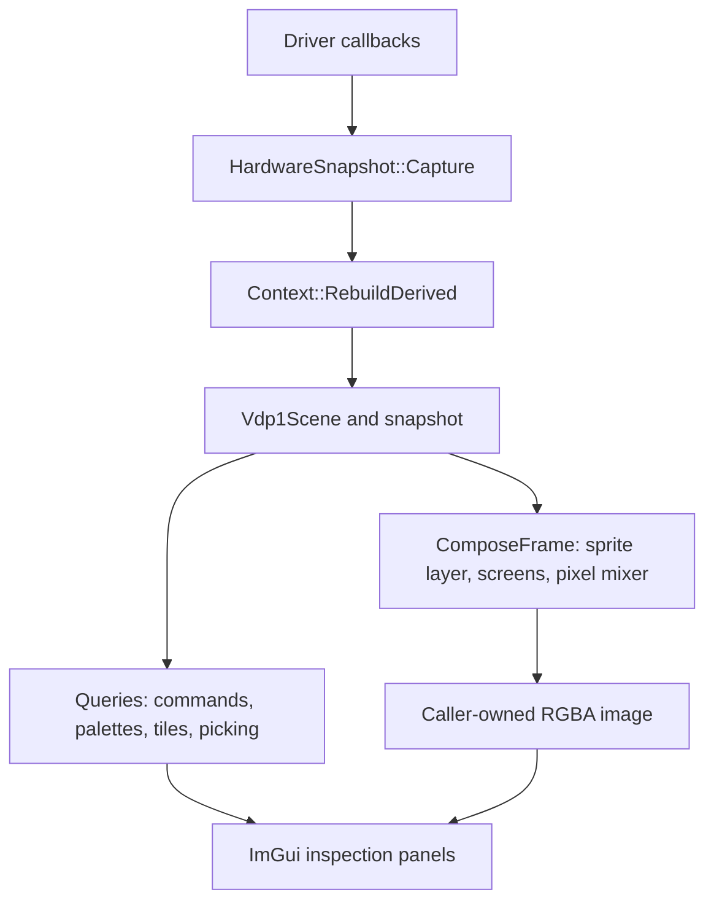

# Graphics reconstruction and inspection

Inspected revision: `ff6a3b1fb1c54e4c0344613094ea65292b0023c2` (2026-10-20).
Evidence status: **verified from source** unless explicitly qualified below.
Paths in prose are relative to `SaturnExplorer/`.

## Purpose and responsibilities

The portable core reconstructs Saturn graphics from captured hardware bytes. It parses VDP1 commands, derives selectable sprites, rasterizes their framebuffer semantics, composites VDP2 screens and exposes images and inspection data through the C host API. The frontend presents those results and owns platform texture handles, camera controls, selection, editing UI and exports. This is reconstruction from state, rather than display of the emulator's already-composited framebuffer.

Start here for a rendering bug: [Context.h](../../../Core/src/Context.h) — `se::Context::ComposeFrame`; for a panel or interaction change, start at [App.cpp](../../../FrontEnd/src/App.cpp) — the relevant `Draw*` method.

## Source locations and important types

| Responsibility | Source and symbols |
|---|---|
| Public embedding boundary | [SeHost.h](../../../include/saturnexplorer/SeHost.h), [SeTypes.h](../../../include/saturnexplorer/SeTypes.h): `se_context`, `se_image`, `se_command`, `se_sprite_2d`, `se_sprite_3d`, `se_render_opts`, `se_camera3d` |
| C ABI validation / exception guards | [HostAbi.cpp](../../../Core/src/HostAbi.cpp): `se_create`, `se_begin_frame`, `se_render_frame`, `se_render_3d` |
| State capture | [HardwareSnapshot.h](../../../Core/src/HardwareSnapshot.h), [HardwareSnapshot.cpp](../../../Core/src/HardwareSnapshot.cpp): `HardwareSnapshot::Capture`, internal `CaptureScope` |
| Derived state, query/cache coordination | [Context.h](../../../Core/src/Context.h): `Context`, `RebuildDerived`, `BuildVramRegions`, `CollectReferences`, `TileMap` |
| Command traversal / decoding | [Vdp1Parser.cpp](../../../Core/src/Vdp1Parser.cpp): `Vdp1Walk`, `Vdp1Parser::Parse` |
| Quads and command-local effects | [GeometryBuilder.h](../../../Core/src/GeometryBuilder.h), [GeometryBuilder.cpp](../../../Core/src/GeometryBuilder.cpp): `GeometryBuilder::Build`, `Vdp1Scene`, `SpriteRender`, `ClipRect`, `DrawFx` |
| VDP1 rasterization and picking | [Vdp1Rasterizer.cpp](../../../Core/src/Vdp1Rasterizer.cpp): `Vdp1Rasterizer::BuildSpriteLayer`, `Render3D`, `HitTest3D`, `RenderSpritePreview`, `PointInSprite` |
| Texels and palette semantics | [Vdp1Color.h](../../../Core/src/Vdp1Color.h), `Context::DecodeTexture`, `DecodePalette`, `DecodeBankPalette`, `ReadCramColors` |
| VDP2 screen decoding and tiles | [Vdp2Compositor.cpp](../../../Core/src/Vdp2Compositor.cpp), [Vdp2Compositor.h](../../../Core/src/Vdp2Compositor.h): `Vdp2Compositor`, `Vdp2TileMap`, `Vdp2TileMapShape`, `EmitExtras` |
| Per-pixel color and priority resolution | [PixelMixer.h](../../../Core/src/PixelMixer.h): `PixColumn`, `MixState`, `ResolveColumns`; [SpriteLayer.h](../../../Core/src/SpriteLayer.h): `SpritePixel`, `SpritePriorityTable` |
| Main inspection UI | [App.cpp](../../../FrontEnd/src/App.cpp): `DrawVdpOutput`, `DrawWorldView`, `DrawCommandList`, `DrawSelectedObject`, `DrawTextureViewer`, `SelectCommand` |
| Sprite row previews | [SpritePreviewCache.h](../../../FrontEnd/src/SpritePreviewCache.h): `SpritePreviewCache::BeginFrame`, `Get` |
| Isolated screens and asset export | [LayerPanels.cpp](../../../FrontEnd/src/LayerPanels.cpp): `LayerPanels::DrawPanel`; [LayerExport.cpp](../../../FrontEnd/src/LayerExport.cpp): `LayerRenderOpts`, `BuildLayerExport`, `WriteLayerExport` |

## Entry points and execution flow

1. `se_create` copies the `se_data_source` callback table into a `Context`. `se_begin_frame` calls `Context::BeginFrame`, which calls `HardwareSnapshot::Capture` followed by `RebuildDerived`.
2. Capture reads only advertised capabilities into owned vectors; short reads reduce the stored length. When both driver capture callbacks exist, `CaptureScope` brackets the reads so all regions and registers can come from the same pinned driver state. A frame number is recorded inside that bracket when supported. A source can be valid with only VDP2, RAM, registers or other available state; VDP1 is not mandatory.
3. `RebuildDerived` calls `Vdp1Parser::Parse` and `GeometryBuilder::Build`, applies display resolution, resolves sprite priorities, builds command-to-preview lookup and VRAM classifications, invalidates tile-map caches, and increments `mDeriveSerial`.
4. `Context::ComposeFrame` seeds the back screen unless transparency was requested; builds the VDP1 `SpritePixel` layer first; emits VDP2 screens with access to sprite-window bits; emits sprites into the same pixel columns; then calls `ResolveColumns`. Sprites are emitted after backgrounds to win equal-priority ties.
5. `App::RenderFrameToTexture` obtains image dimensions/required bytes, supplies its own pixel buffer, calls `se_render_frame` again and uploads the result through `IPlatform`. `DrawVdpOutput` displays that texture. Render-option toggles are core inputs; they do not require emulator-side layer disabling.
6. `DrawWorldView` supplies `se_camera3d` to `se_render_3d`. `Context::CollectLayerPlanes` renders isolated VDP2 screens to cached textures behind the sprite depth stack; `Vdp1Rasterizer::Render3D` produces an RGBA image in software. The platform uploads that image rather than rasterizing the scene itself.



## Interactions and user actions

- **Select an object:** `DrawVdpOutput` calls `se_hit_test`; `DrawWorldView` calls `se_hit_test_3d`; both feed `App::SelectCommand`. The shared identity is the VDP1 command index, not a sprite vector index. Command rows include control commands that have no drawable sprite.
- **Inspect raw art:** `DrawTextureViewer` uses the selected command's texture reference; the core decodes texels and the appropriate CLUT or color bank. References come from `Context::ReferencesOfTexture` / `ReferencesOfPalette`, which scan decoded commands through `CollectReferences`.
- **Preview a command row:** `DrawCommandList` requests only visible-row previews through `SpritePreviewCache::Get`. `se_render_sprite_preview` renders that command in isolation with bounded supersampling. It is different from decoding a texture: it includes distortion, geometry, clipping and shading.
- **Edit a command/sprite:** `App::WriteCommandWord`, `EditCommandSize`, `EditCommandPosition` and `MoveSelectedSprite` change command bytes through the memory-edit path. `Context::WriteVram` forwards to an available driver write sink before changing accepted bytes in the local snapshot, then calls `RebuildDerived`. Without a sink, edits are local to the snapshot. `SetVdp1Register` / `SetVdp2Register` update captured registers and re-derive; these setters do not themselves forward register writes to the emulator.
- **View/export one layer:** `App::DrawLayerPanels` supplies `LayerPanelFrame` with current context/options/frame. `LayerRenderOpts` selects one layer over transparency. `BuildLayerExport` builds BMP images and CSV tile indices; `WriteLayerExport` handles filesystem publication. This export logic has no ImGui/platform dependency. Bitmap backgrounds have no tile-map export.
- **Find art on disc / break on modification:** `App::BeginTextureSearch`, `BuildTextureNeedle` and `BreakOnTextureWrite` connect selected graphics to search and debugger facilities. Those systems own search execution and breakpoints; the core owns neither.

## State, lifetime and invalidation

`Context` owns `HardwareSnapshot`, command/scene vectors, render/mixer buffers, sprite-priority state, VRAM classifications and lazy tile maps. Destruction calls the driver's `close` callback under `GuardVoid`; the driver's user state must remain valid until then. Image output is copied into caller-owned memory; the C API does not expose a borrowed internal RGBA buffer.

Captured data remains stable between captures **except** explicit memory/register edits. `RebuildDerived` is the invalidation center for captures and those edits. `se_derive_serial` is the frontend cache key; do not infer freshness from frame number alone. Tile maps are lazy because large maps require a full pattern-name walk. `se_get_vdp2_tilemap_shape` reads register-defined shape without that walk, and should be used for per-frame toolbar metadata. `CollectLayerPlanes` keys its cache on derive serial plus relevant render options.

`LayerPanels::DrawPanel` renders only a visible/un-collapsed panel and reuses its texture while `RenderKey::Matches` succeeds. `SpritePreviewCache` caches row-to-content keys per derive serial and GPU textures by content hash across identical captures; eviction avoids destroying textures already referenced by the current ImGui draw list.

There is no core render-worker synchronization in this implementation: the inspected `App::BuildUI` path captures, queries and renders serially on the UI path. **Inference:** treat a `Context` and its mutable caches as single-caller objects unless adding explicit synchronization. Driver capture pinning protects the source snapshot; it does not make arbitrary concurrent `Context` queries safe.

## Extension points and constraints

| Requested change | Inspect/reuse first | Preserve |
|---|---|---|
| Fix sprite shape, scaling or command interpretation | `Vdp1Parser`, `GeometryBuilder`, `Vdp1ScaledSprite.h` | Parser and geometry must agree on command traversal and scaled extents |
| Fix sprite pixel effects / palette / transparency | `Vdp1Rasterizer`, `Vdp1Color.h`, `SpritePriorityTable` | VDP1 operates on framebuffer words before VDP2 interprets their color/priority/window fields |
| Fix background scrolling, rotation, windows or color mixing | `Vdp2Compositor`, `PixelMixer.h`, `Context::ComposeFrame` | Sprite-window state is needed before backgrounds emit; color mixing is per pixel |
| Add an inspection query or render option | `SeHost.h`, `SeTypes.h`, `HostAbi.cpp`, `Context` | Flat C ABI, caller-owned buffers, argument checks and no escaping exceptions |
| Add/change a layer view or export | `LayerPanels`, `LayerRenderOpts`, `BuildLayerExport`, `FetchCoreImage` | Same core render options for displayed/exported art; filesystem failure handling stays independently testable |
| Add command-row artwork or change preview sizing | `SpritePreviewCache`, `Context::RenderSpritePreview` | Non-drawable commands return no image; bounded work and content-aware invalidation |
| Add graphics edit behavior | `App` edit functions, `Context::WriteVram`, driver sinks | Update only accepted bytes; re-derive after mutation; distinguish local preview from emulator persistence |

Raw VDP bytes are big-endian; reuse [ByteOrder.h](../../../Core/src/ByteOrder.h). `Vdp1Walk` bounds runaway traversal at 0x4000 commands and stops out-of-range links/cycles. `Vdp1Scene` has parallel sprite/render arrays; `command_index` is their bridge to command rows. VDP1 framebuffer and display dimensions differ in hi-res/exclusive modes; picking and previews must preserve the same scan-out scaling as rendering. Image APIs use a size-query/fill pair and `SE_ERR_BUFFER_TOO_SMALL`, rather than lending mutable internal buffers. Core and savestate code compile as C++14.

## Confirmed limitations and investigation boundaries

- Vertical mosaic is explicitly unmodeled in `Vdp2Compositor.h`; the horizontal mosaic implementation is present. This is a declared coverage limit, not a newly diagnosed regression.
- The exploded 3D representation places all VDP2 planes behind sprites (`Context::CollectLayerPlanes`). It cannot encode the composite's per-pixel sprite/background ordering. Planes are inspection context, not reconstructed original game-world geometry.
- `Context::HitTest` is a reverse-order geometric quad test after display-to-framebuffer scaling; it does not ask which nontransparent texel won the final composite. Do not describe 2D selection as pixel-accurate visible-surface picking.
- Sprite previews exclude other commands' occlusion and destination-dependent blending, as specified by `se_render_sprite_preview` in `SeHost.h`.
- Hardware correctness was mapped through source and synthetic test coverage; this investigation did not rerun real-game golden renders or independently validate every Saturn register equation.
- Existing `ARCHITECTURE.md` contains earlier GPU-pipeline language for the 3D view. Current `App::DrawWorldView` calls `se_render_3d` and uploads its software-rendered RGBA image; use the implementation and current `SeHost.h` contract for that path.

## Testing and verification

Configure/build from `SaturnExplorer/` using [BUILD.md](../../BUILD.md); test targets are declared in [CMakeLists.txt](../../../CMakeLists.txt).

```sh
cmake -S . -B build
cmake --build build -j8
ctest --test-dir build --output-on-failure -R 'SaturnExplorer(Vdp2|Vdp1Preview|CramWrap|Geometry3D|VramMap|AbiNoThrow|LayerExport|LayerPanel|PanelInteraction)Tests'
```

| Tests | What they exercise |
|---|---|
| [Vdp2CompositorTests.cpp](../../../Core/tests/Vdp2CompositorTests.cpp) | ABI-level synthetic state, VDP1/VDP2 rendering and color/priority/window cases |
| [Vdp1PreviewTests.cpp](../../../Core/tests/Vdp1PreviewTests.cpp) | Deterministic work/byte limits for 64×64 previews of differently sized native quads |
| [Geometry3DTests.cpp](../../../Core/tests/Geometry3DTests.cpp) | Front view projection, orbit sense, picking, transparent/collapsed primitives and screen planes |
| [CramWrapTests.cpp](../../../Core/tests/CramWrapTests.cpp) | Palette addressing and color RAM behavior |
| [VramMapTests.cpp](../../../Core/tests/VramMapTests.cpp) | VRAM classifications and command/scaled-sprite cases |
| [AbiNoThrowTests.cpp](../../../Core/tests/AbiNoThrowTests.cpp) | Allocation failures and callback exceptions at the C ABI |
| [LayerExportTests.cpp](../../../FrontEnd/tests/LayerExportTests.cpp) | Export contents and publication failure paths |
| [LayerPanelTests.cpp](../../../FrontEnd/tests/LayerPanelTests.cpp) | Layer-panel behavior with headless ImGui |
| [PanelInteractionTests.cpp](../../../FrontEnd/tests/PanelInteractionTests.cpp) | Shared widget interaction and command-preview UI behavior |

[FakeVdpSource.h](../../../Core/tests/FakeVdpSource.h) is the reusable synthetic Seam A source. [Core/tools/SeRender.cpp](../../../Core/tools/SeRender.cpp) builds `se-render`: feed a reproducible `.sedump`, use `--reference`, `--diff`, `--tolerance` for comparisons, and `--layer nbg0|nbg1|nbg2|nbg3|rbg0|vdp1` for isolation. Extend synthetic fixtures for the register/command case being changed, then compare a real dump when visual fidelity is the goal.

## Related documentation

- [Architecture](../../ARCHITECTURE.md): seams and historical module rationale.
- [VDP1 guide](../../VDP1_GUIDE.md), [VDP2 guide](../../VDP2_GUIDE.md): hardware semantics and user workflow.
- [Build instructions](../../BUILD.md).
- [Knowledge-base index](../README.md), [feature map](../FEATURE_MAP.md).
