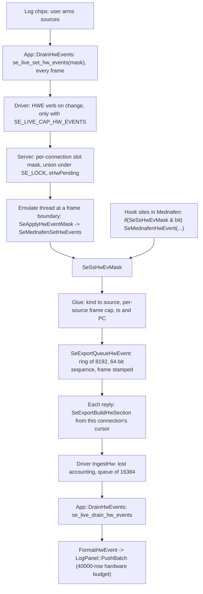

# Hardware events

Inspected revision: `e27a9149591943284ac2b372d4660a9e8ca61c0e` (2026-11-26). Everything below is
verified from source and from the tests listed in "Testing"; "Coverage limits" says what no test or run
has reached. Design record: [DebuggerFeaturesPlan.md](../../DebuggerFeaturesPlan.md) Part 1 (source takes
precedence over it where they differ).

## Purpose and responsibilities

The hardware event log reports what the emulated machine does, not what the game's code asks for:
SH-2 interrupts and exceptions taken, SCU interrupts delivered and mask writes, SCU DMA, the SH-2 on-chip
DMAC, VDP1 draws and frame-buffer swaps, VBlank edges, CD block commands and SMPC commands. The patched
emulator turns each into a fixed 32-byte record; the live protocol carries them to the Log panel, which shows
them under the CPU, DMA, VDP, CD and SMPC chips.

It owns the record layout, the enable mask and its lifecycle, the emulator-side ring and per-frame cap, the
opt-in wire section and the Log panel's capture controls and row budget. It does not own the tracepoint
event path (see [Debugger](Debugger.md)), which is a separate queue with a different record, and it does not
store events in recorded frames: they are live-only.

## Source locations, types and entry points

| Responsibility | Source and important symbols |
|---|---|
| Record, kinds, enable bits, ring size and per-frame cap (single definition for emulator, exporter, driver and front end) | [SeHwEvents.h](../../../Integration/Common/SeHwEvents.h): `SeHwEvent`, `SE_HWEV_EN_*`, `SE_HWEV_K_*`, `SE_HWEV_EXC_*`, `SE_HWEV_F_*`, `SE_HWEV_RING`, `SE_HWEV_FRAME_CAP` |
| Wire contract | [SeLiveProtocol.h](../../../Integration/Common/SeLiveProtocol.h): `SE_LIVE_VERB_HWEVENTS` (`HWE\n`), `SE_LIVE_CAP_HW_EVENTS`, `SE_LIVE_MINVER_HWEVENTS`, "Hardware event section", `SE_LIVE_HWEV_*` |
| Emulator hooks | [apply.py](../../../Integration/Mednafen/apply.py): `process_hwevents`, `HWEV_EXC`, `HWEV_DMAC_*`, `HWEV_SCU`, `HWEV_CD`, `HWEV_SMPC`, `HWEV_VDP1`, `HWEV_VDP2`, `HWEV_KEYS`; every fence is `SE_HWEV_*`-keyed and insert-only |
| Glue (stamping, cap, DMAC shadow, resets) | [se_mednafen_glue.c](../../../Integration/Mednafen/se_mednafen_glue.c): `SeSsHwEvMask`, `SeMednafenHwEvent`, `SeMednafenDmacRecalc`, `SeMednafenSetHwEvents`, `SeMdfnHwEvEndFrame`, `SeMdfnHwEvForget`, registration in `SeMednafenFrameHook`, call from `SeMednafenEndFrameHook` |
| Server | [se_export.c](../../../Integration/Common/se_export.c): `SeExportSetHwEventHook`, `SeHwSetRequest`, `SeHwRecomputeLocked`, `SeApplyHwEventMask`, `SeExportQueueHwEvent`, `SeExportBuildHwSection`, `SeExportHwEventMask`, `SeConnHw`, the `HWE` branch of `SeServeClientRequests`; declarations in [se_export.h](../../../Integration/Common/se_export.h) |
| Client driver | [LiveDriver.cpp](../../../Drivers/Live/src/LiveDriver.cpp): `LiveHw`, `HwQueue`, `IngestHw`, the section parse in `ReadSnapshot`, `hwWanted` / `hwDirty` / `hwSection` in `PollLoop`; [LiveDriver.h](../../../Drivers/Live/src/LiveDriver.h): `se_live_hw_event`, `se_live_set_hw_events`, `se_live_drain_hw_events`, `se_live_hw_status_get` |
| Text and names | [HwEventFormat.cpp](../../../FrontEnd/src/HwEventFormat.cpp): `FormatHwEvent`, `FormatHwLost`, `HwEventDetail`, `HwEventCategory`, the `Hw*Name` tables |
| Log panel | [LogPanel.cpp](../../../FrontEnd/src/LogPanel.cpp): `kHwChips`, `LogPanel::DrawChips`, `PushEvent`, `PushBatch`, `RebuildIfDirty`, `Load` / `Store`; [LogPanel.h](../../../FrontEnd/src/LogPanel.h): `HwChipStatus`, `kHwCap`, `kOtherCap` |
| App glue | [App.cpp](../../../FrontEnd/src/App.cpp): `App::DrainHwEvents` (called from the live update next to `DrainTraceEvents`), `App::ResolveRestoreWait` (the discontinuity row), `mLog.Load` / `mLog.Store` |

## Execution flow



## Record and section layout

The record is 32 bytes (`SeHwEvent`, size-checked in C and C++): `kind`, `source` (bit index 0..7 of the
`SE_HWEV_EN_*` that produced it), `cpu` (0 master, 1 slave, `SE_HWEV_CPU_NONE`), `flags`
(`SE_HWEV_F_HAS_PC`, `SE_HWEV_F_PC_APPROX`), `frame`, `ts`, `pc`, `arg[4]`. `frame` is stamped by the exporter
in `SeExportQueueHwEvent` with the committed frame number `sFrameNo`, exactly as the tracepoint events are:
for an event produced while frame N executes it is N-1 (and 0 before the first frame completes), so it is a
display hint, never a key, and it differs by one from the frame identity the Profiler uses. `ts` is the master
SH-2 clock (`SsDbgCpuTimestamp(0)`), frame-relative; device events can be off by the scheduler's slack.

The reply section follows the perf section, on a connection that has sent `HWE`, and is built by
`SeExportBuildHwSection`:

| Field | Meaning |
|---|---|
| `u32 count` | records that follow, at most `SE_LIVE_HWEV_MAX_PER_REPLY` (512); records beyond the cap stay owed to the connection, they are not lost |
| `u32 recordLen` | 32; the driver reads `recordLen` bytes per record and ignores a longer tail; below 32 or above 256 is a broken stream (`ReadSnapshot` returns false) |
| `u64 firstSeq`, `u64 newestSeq` | sequence of the first record (consecutive) and of the newest one produced |
| `u64 lost` | records that fell out of the ring behind this connection's cursor, immediately before `firstSeq` |
| `u32 appliedMask`, `u32 supportedMask` | the mask the emulate thread runs with, and the bits the build has hooks for |

The kind-by-kind meaning of `arg[0..3]` is in [SeHwEvents.h](../../../Integration/Common/SeHwEvents.h); the hook
table below says what each hook passes.

## Opt-in rule and why the protocol stays v27

A connection that never sends `HWE` gets byte-identical v27 replies: `hw->optedIn` stays 0, so
`SeServeClientLoop` never appends the section. From the reply to a connection's first `HWE` the section is on
every reply of that connection, sticky, even if the mask later goes back to 0. Because nothing changes for
other clients, no version bump is needed, which keeps every shipped v27 application able to talk to a new
emulator. The cost of that choice is that a v27 server without the feature cannot be told apart by version:
it would answer `HWE` as a plain `GET` with no section, and a client would wait for one. So the driver gates
at its single send point: `HWE` is replaced by `GET` unless `srvCaps` has `SE_LIVE_CAP_HW_EVENTS`
(`MinVerFor(HWE)` = 27 is only a second guard), and `App::DrainHwEvents` also reports "capable" to the panel
only for `se_live_server_version >= SE_LIVE_MINVER_CAPS` with the bit set. The server sets the bit from the
very first reply when the glue registered `SeExportSetHwEventHook` before `SeExportStart` (every build of this
glue does: the hooks need no debugger loop). A build without a registered hook, such as the Yabause tap that
shares `se_export.c`, leaves the bit clear.

| Client | Server | Result |
|---|---|---|
| older v27 | with hardware events | never sends `HWE`, never sees the section |
| with hardware events | older v27 or without the hook | capability bit clear, `HWE` never sent |
| with hardware events | with hardware events | section flows after the first `HWE` |

## Enable mask lifecycle

1. The Log panel's armed sources (`LogPanel::HwRequestMask`) go to `se_live_set_hw_events` every frame
   (0 unless live and capable). The driver records `hwWanted` and sets `hwDirty` only on a change; a new
   connection sets `hwDirty` only if the wanted mask is non-zero, so a session that never arms anything never
   opts in.
2. The server stores the mask in the connection's slot (`sHwSlotMask[slot]`, the same slot index the profiler
   request uses), masked with `sHwSupported`. `SeHwRecomputeLocked` ORs every used slot under `SE_LOCK`
   and raises `sHwPending` on a change. Releasing the slot (`SeProfRelease`, reached from `SeServeClient` for
   every way a connection ends) clears its bits, so a departed client cannot leave events on.
3. Only the emulate thread applies it, at a frame boundary: `SeApplyPendingInstalls` calls `SeApplyHwEventMask`
   when `sProfAtBoundary` is set, which is the case for `SeExportApplyInstalls` (called from
   `SeMednafenEndFrameHook`) and for `SeExportGateFrame`, but not for the mid-frame halt gate
   (`SeExportGateHalt`). A request that arrives during a breakpoint halt therefore waits for the next frame
   boundary. `SeApplyHwEventMask` clears the pending flag before reading the union, so a request that lands in
   between is applied on the next boundary and the last one wins.
4. `SeMednafenSetHwEvents` writes `SeSsHwEvMask` (masked with `SE_MDFN_HWEV_SUPPORTED`, 0xFF), re-seeds the
   DMAC shadow when that source is turned on, and zeroes every per-source frame counter.
5. The section header's `appliedMask` tells the client what is actually running; the Log chip shows
   "(pending)" while an armed bit is not in it, and "(unavailable)" when the chip's sources are all outside
   `supportedMask`.

Events are produced only while a bit is in the applied mask. While a request is pending nothing changes in
the emulator: a newly armed source produces nothing until the boundary, and a source switched off keeps
producing until it. Those late records are still queued unless the union is 0 (`SeExportQueueHwEvent`
returns early when `sHwWanted == 0` or no client is attached), and they are not filtered per connection: the
ring is one stream for the union of all masks, and every opted-in connection receives all of it (the server
is deliberately not filtered per connection). `LogPanel::PushBatch` therefore drops records whose source bit is
not in the panel's own request mask, so another connection's sources cannot use up the 40000-row hardware
budget; gap markers carry no source and are kept.

A connection that finds every slot taken (`SeProfAcquire` returns -1; two listeners serve one client each
against eight slots, so this is a safeguard) cannot have its request recorded. The HWE verb still opts it in,
and its section reports `supportedMask` 0 (`SeExportHwCursor.noSlot`, set where the connection starts), which
`se_live_hw_status_get` hands on as `supported_mask == 0` and the chip shows as "(unavailable)" instead of
waiting for an applied mask that cannot come. The profiler verb has no such report; it ignores the request.

## Per-frame cap and the SUPPRESSED record

`SeMednafenHwEvent` re-tests the mask (so a call that raced a boundary is inert), maps the kind to its source
(`SeMdfnHwEvSource`), and lets through at most `SE_HWEV_FRAME_CAP` (64) records per source per frame; the DMAC
hook applies the same counter itself. The excess is counted. `SeMdfnHwEvEndFrame`, called from
`SeMednafenEndFrameHook` after the profiler's frame and before `SeExportApplyInstalls`, queues one
`SE_HWEV_K_SUPPRESSED` record per source whose count exceeded the cap and whose bit is still set (arg0 =
suppressed count, arg1 = the cap, `source` = the source), then zeroes the counters. The counters are also
zeroed by `SeMednafenSetHwEvents` (any mask change) and by `SeMdfnHwEvForget` (a state load, through
`SeMednafenStateLoaded`). The panel renders the record as "... +N more <source> events this frame (cap 64)" in
the chip of its source. The cap is a compile-time constant; the 8192-record ring and the 512-record reply cap
are separate limits.

## Loss accounting

- **Emulator side.** The ring (`sHwRing`, 8192 records) overwrites the oldest and never blocks the producer.
  Each connection's cursor (`SeExportHwCursor`) starts at the newest sequence on its first reply (no backlog is
  owed, and that is not a loss). If the cursor falls more than `SE_HWEV_RING` behind, `SeExportBuildHwSection`
  moves it forward and reports the exact count in the header's `lost`.
- **Driver side.** `IngestHw` adds the header's `lost` to `serverLost` and to `pendLost`, treats any further
  sequence gap before a record as a loss too (`expect = seen + 1 + lost`), skips duplicates, and attaches the
  pending count to the next queued record as `lost_before`. The driver's queue is bounded at 16384
  (`kHwQueueBound`); an eviction increments `driverEvicted` and the record that becomes the oldest inherits the
  evicted record's `lost_before + 1`, so the count stays exact however far it overflows.
- **Panel side.** `App::DrainHwEvents` inserts a Warning row from `FormatHwLost` ("N hardware events lost
  (emulator ring / client queue)") before the record that carries `lost_before`, i.e. at the gap. The Log
  panel's own eviction (below) is not reported.
- Totals are readable with `se_live_hw_status_get` (`newest_seq`, `server_lost`, `driver_evicted`,
  `applied_mask`, `supported_mask`); it returns 0 until a section has arrived.

## Hooks and what their arguments mean

All hooks are insert-only fences added by `process_hwevents`, each `if(MDFN_UNLIKELY(SeSsHwEvMask &
SE_HWEV_EN_x)) SeMednafenHwEvent(...)`, so a site costs one load and a not-taken branch while the log is off.
None is in a per-instruction or per-bus-access path. The two that run often test the mask first
(`SCU_SetHBVB` once per H phase, `CheckDoMasterInt` per interrupt check).

| Source (bit) | File, site | Event and arguments |
|---|---|---|
| CPU_EXC 0x01 | `sh7095_ops.inc`, after each `Exception(...)` (INT, NMI, CPUADDR, DMAADDR, ILLINSTR, ILLSLOT, and TRAPA by its own anchor); `Step<>` and the slave's resumable copy alike | `SH2_EXCEPTION`: cpu, `pc` = saved PC (exact, `SE_HWEV_F_HAS_PC`); arg0 vector, arg1 `SE_HWEV_EXC_*`, arg2 interrupt level (INT only, else 0), arg3 handler PC (`opexec_new_PC`). For TRAPA arg0 is the instruction's immediate byte |
| SCU_INT 0x02 | `scu.inc`, `CheckDoMasterInt` after `IPending &= ~(1U << bpos)` | `SCU_INT_ACCEPT` (delivered, not raised, because `SetInt` fires per HBlank line): arg0 source bit, arg1 level, arg2 vector, arg3 `IPending` after the bit was cleared |
| SCU_INT | `scu.inc`, the IMS write (`case 0xA0`), before `IMask` takes the value | `SCU_INT_MASK`: arg0 new IMask, arg1 old IMask |
| SCU_DMA 0x04 | `scu.inc`, `StartDMATransfer` after `d->ReadFunc = rftab[rb]` (once per indirect table entry) | `SCU_DMA_START`: arg0 `level \| indirect<<8 \| startFactor<<16 \| readBus<<24 \| writeBus<<28` (bus 0 A, 1 B, 2 C), arg1 source, arg2 destination, arg3 byte count |
| SCU_DMA | `scu.inc`, `DMALevel[level].Active = false;` in `SCU_DoDMAEnd` | `SCU_DMA_END`: arg0 level |
| SCU_DMA | `scu.inc`, the two "Attempted DMA from/to illegal address" refusals | `SCU_DMA_ILLEGAL`: arg0 `level \| side<<8` (side 0 = the source was refused, 1 = the destination), arg1 source, arg2 destination (both hooks pass both; `HwEventFormat.cpp` prints the refused one by side and the other for context). The hook keys are `SE_HWEV_HOOK_SCU_DMA_SRC_REFUSED` / `_DST_REFUSED`; `apply.py` retires the earlier `_BADSRC` / `_BADDST` fences so a re-apply over an old tree migrates them |
| SH2_DMAC 0x08 | `sh7095.inc`, top of `DMA_RecalcRunning`, through `SeMednafenDmacRecalc` | `DMAC_START` / `DMAC_END` are edges of a per-CPU shadow of the channel run conditions. START: cpu, `pc` approximate (`SE_HWEV_F_PC_APPROX`, read with `SsDbgSh2Regs`), arg0 `ch \| CHCR<<8`, arg1 SAR, arg2 DAR, arg3 TCR. END: arg0 channel, no PC. The shadow is unknown after a state load, a CPU reset and when the source is switched on, and the first recalc then only seeds it |
| VDP1 0x10 | `vdp1.cpp`, top of `StartDrawing` | `VDP1_DRAW_START`: arg0 draw frame buffer, arg1 `DrawingActive` at entry. The frame-buffer-swap path clears `DrawingActive` first (and reports the abort as a DRAW_END), so arg1 is 1 only for a start by a `PTMR` write while drawing |
| VDP1 | "Drawing finished" | `VDP1_DRAW_END`: arg0 byte address of the END command (`CurCommandAddr << 1`), arg1 0 |
| VDP1 | "Drawing aborted by framebuffer swap" | `VDP1_DRAW_END`: arg0 command address where it was cut, arg1 1 |
| VDP1 | "Displayed framebuffer changed" | `VDP1_FB_SWAP`: arg0 displayed frame buffer, arg1 FBCR, arg2 TVMR |
| VDP1 | "VB erase start of framebuffer" | `VDP1_FB_ERASE`: arg0 frame buffer, arg1 EWDR, arg2 EWLR, arg3 EWRR. Fires only when the V-blank erase is armed (`TVMR` VBE, or the pending flag set by rotation); an erase that runs without it produces no event |
| VDP2 0x20 | `scu.inc`, `SCU_SetHBVB`, only when the VBlank level changed | `VDP2_VBLANK`: arg0 1 IN / 0 OUT. It sits before the `SetInt` calls of the same edge |
| VDP2 | `vdp2.cpp`, the TVMD write, only when the display bit changes | `VDP2_DISPLAY`: arg0 1 on / 0 off, arg1 the TVMD value |
| CD 0x40 | `cdb.cpp`, after `CTR.Command = CTR.CD[0] >> 8` in the command coroutine | `CD_COMMAND`: arg0..3 = CR1..CR4 (command in the high byte of CR1) |
| CD | end of `BasicResults` and of `CDStatusResults` | `CD_RESPONSE`: arg0..3 = Results[0..3] (status in the high byte of Results[0]). Every caller is inside the command switch; the periodic status report and the disc-authentication result write `Results[]` directly and are not logged |
| SMPC 0x80 | `smpc.cpp`, after `OREG[0x1F] = ExecutingCommand` (commands below 0x20) | `SMPC_COMMAND`: arg0 command, arg1 IREG0..3 (IREG0 in the low byte), arg2 IREG4..6. The hook runs when the command starts executing (92 SMPC clocks after it was picked up), not when COMREG is written; INTBACK continuations are not logged |

Hooks inside coroutine-style bodies (`cdb.cpp`, `smpc.cpp`, the VDP1 draw loop) are plain statements with no
declaration. Device events carry no CPU and no PC.

## Log panel behaviour

- **Chips.** CPU, DMA, VDP, CD and SMPC are capture toggles; each arms one or two sources (`kHwChips`):
  CPU = SH-2 exceptions + SCU interrupts, DMA = SCU DMA + on-chip DMAC, VDP = VDP1 + VDP2, CD, SMPC.
  A click arms every source of the chip and shows its rows, a second click disarms and hides them. Right-click
  opens a menu of the chip's sub-sources; the chip is shown when any of them is armed. An armed chip is full
  colour, a shown-but-not-armed chip (after **All**) is dimmed, a hidden one is disabled text. **All** only
  changes visibility; it never arms capture. The chips start hidden, so a session that never arms one never
  asks the emulator for anything.
- **Pending.** The label gains " (pending)" while an armed bit is not yet in the server's applied mask; the
  tooltip says the emulator applies the change at the next frame boundary (a halt delays it, see above).
  **Unavailable** replaces it when the server reports no supported source for the chip (no free connection slot,
  or not in this build).
- **Disabled states.** With no live connection the chips are disabled and the tooltip says the setting is kept
  and applies on connect; with a live server lacking `SE_LIVE_CAP_HW_EVENTS` they are disabled with "no
  hardware event support". A sub-source the server's `supportedMask` does not contain is greyed in the menu
  ("not in this build") once a section has arrived (`HwChipStatus::statusValid`).
- **Rows.** `FormatHwEvent` builds the one-line message, category and, for kinds with `SE_HWEV_F_HAS_PC`, a
  clickable source (the SH-2 exception PC, exact; the on-chip DMAC start PC, marked approximate). The decoded
  arguments are not built per row: the raw record stays on the entry and `HwEventDetail` decodes it when the row
  is selected. An unknown kind renders as `kind 0x.. a0 a1 a2 a3`. Name tables (vectors, CD commands, SMPC
  commands, SCU sources and buses) exist only in `HwEventFormat.cpp`.
- **Row budget.** Hardware rows live in their own deque (`kHwCap` = 40000) apart from everything else
  (`kOtherCap` = 10000), so a flood cannot push tracepoint or Info rows out; the oldest hardware row is always
  the one to go, whatever its category or visibility. `PushEvent` appends to the filtered index in O(1) while
  nothing is evicted; an eviction, a filter change or a search change marks the index dirty and
  `RebuildIfDirty` merges the two seq-ordered deques again. Only the rows on screen are submitted (a clipper).
- **Persistence.** The armed sub-sources are stored as booleans under the `Log` section of the settings file
  (`LogPanel::Store`, keys `cpuexceptions`, `scuinterrupts`, `scudma`, `dmac`, `vdp1`, `vdp2`, `cd`, `smpc`) and
  read at start (`LogPanel::Load`); on the next connection they are asked for without a click.
- A state restore through the slot machinery moves the frame counter, so `App::ResolveRestoreWait` adds one Info
  row ("State restored; hardware event frame numbers continue from N") when capture is armed. A rewind seek does
  not pass through that wait and adds no row.

## State, ownership and invalidation

- `SeSsHwEvMask`, the frame counters and the DMAC shadow are the emulate thread's. The ring, `sHwSeq` and the
  slot masks are guarded by `SE_LOCK`; `sHwWanted`, `sHwPending` and `sHwApplied` are atomics. Each connection's
  cursor is local to its serving loop, so the local socket and the TCP client both get every record.
- The driver's queue and counters are guarded by `ctlMtx` and reset on a new connection (`firstOnConnection`),
  where the sequence also starts again from the server's new counting. `hwSection` is connection-local.
- **State load** (`SeMednafenStateLoaded`): frame counters and the DMAC shadow are forgotten; the ring, its
  sequence and every cursor are untouched, and the frame number in later records follows the restored counter.
- **Reconnect:** the new connection has not opted in; the driver re-sends the wanted mask when it is non-zero
  and its cursor starts at the newest record, so nothing from before it is delivered.
- **Halt:** a mid-frame halt does not apply a pending mask change (the halt gate, `SeExportGateHalt`, passes
  boundary 0); producing continues with the old mask until the next frame boundary, so a source armed while the
  emulator sits at a breakpoint shows "(pending)" and produces nothing until the run resumes through one.
  This is deliberate: the hook counters and the DMAC shadow are only consistent at a boundary.
- **Server restart in-process** (`SeExportPrepare`) zeroes the ring sequence, the mask state and the registered
  hook, but first calls the old hook with mask 0 so the glue's `SeSsHwEvMask` is 0 too. The emulator prepares once
  per process; whoever prepares again must call `SeMednafenRegisterHwEvents` again for requests to reach the glue
  (`HwEventGlueTests`, `TestRePrepare` in `LiveHwEventTests`).
- The panel's rows are UI-thread state, cleared by `LogPanel::Clear` only.

## Extension points and constraints

| Task | Start here; preserve |
|---|---|
| Add an event kind | Append to `SeHwEvents.h` (never reuse a value), add its source mapping in `SeMdfnHwEvSource`, a fence in `apply.py` with a new key listed in `HWEV_KEYS` / `HWEV_KEY_FILE`, text in `HwEventFormat.cpp`. An older front end renders an unknown kind generically |
| Add a source | A new `SE_HWEV_EN_*` bit, `SE_MDFN_HWEV_SUPPORTED`, a chip entry in `kHwChips` and the settings key |
| Change a record | The record is 32 bytes and `recordLen` is read per record; append, never reorder. Wire limits live in `SeLiveProtocol.h` only |
| New hook | A new fence under a new key; an existing key is left alone by `apply.py`, so editing a fence does not update an already patched tree |

## Testing

```sh
ctest --test-dir build --output-on-failure -R 'HwEvent|LogPanel|MednafenProfilerHooks|V1Guest'
```

- [HwEventGlueTests.c](../../../Integration/tests/HwEventGlueTests.c) (`SaturnExplorerHwEventGlueTests`): the
  real glue with the sink captured: mask 0 inert, kind-to-source mapping, the per-source cap and SUPPRESSED
  record, the DMAC edge shadow, and the resets.
- [HwEventsHeaderTests.c](../../../Integration/tests/HwEventsHeaderTests.c) (`SaturnExplorerHwEventsHeaderTests`):
  32 bytes in C and C++, wire lengths and the capability value.
- [LiveHwEventTests.cpp](../../../FrontEnd/tests/LiveHwEventTests.cpp) (`SaturnExplorerLiveHwEventTests`): the
  real exporter and driver in lockstep on a private socket and port, plus a scripted server: the section absent
  without opt-in, the capability, the mask applied only at a boundary and at the frame gate, union and release
  on leave (including a TCP client and an abrupt disconnect), the 512 per-reply cap, exact ring-overrun
  and driver-eviction counts, no backlog for a fresh connection, restate on reconnect, and the driver's
  refusal to send `HWE` to a server without the capability or an old version.
- [HwEventFormatTests.cpp](../../../FrontEnd/tests/HwEventFormatTests.cpp) (`SaturnExplorerHwEventFormatTests`):
  golden text for every kind, the name tables, the unknown-kind fallback and how the PC flags reach the entry.
- [LogPanelTests.cpp](../../../FrontEnd/tests/LogPanelTests.cpp) (`SaturnExplorerLogPanelTests`): chips arm and
  persist, **All** does not arm, disabled states, the pending label, the right-click menu, lost and suppressed
  rows, the PC jump, 50000 rows through the clipper and the auto-scroll.
- [check_apply_hooks.py](../../../Integration/tests/check_apply_hooks.py) (`SaturnExplorerMednafenProfilerHooks`):
  every hook key present once and guarded by a mask test at the start of its statement, the exception fences
  placed after the profiler's ownership fence, and the SMPC and CD hook packing compiled.
- With a Mednafen checkout (`_emu/mednafen`): `Integration/Mednafen/check_component.py <root> <work> <c++>
  --only hwev_vdp1 hwev_sh2` runs [hwev_harness.cpp](../../../Integration/Mednafen/component/hwev_harness.cpp)
  on the real patched `vdp1.cpp` and the real SH-2 core, SCU and DMAC against the real glue; its `--drop <key>`
  and `--mutate hwev-mask-ignored` / `hwev-wrong-kind` options must each make it fail. `check_migration.py`
  covers upgrade from earlier `apply.py` versions. These are scripts, not registered tests: the CTest entry for
  `check_component.py` runs only the F8 bus harness.
- [V1 EXPECTED_EVENTS.md](../../../Integration/Validation/V1/EXPECTED_EVENTS.md) derives, per phase, the events
  the V1 guest must produce; `SaturnExplorerV1Guest` pins the parts of that derivation the fake machine can
  show.

## Coverage limits

- **No patched emulator has been booted with these hooks** and read back through the log; no number in
  `EXPECTED_EVENTS.md` has been compared with a run.
- Behaviourally tested on the real patched source (`hwev_harness.cpp`, needs the checkout and is not in
  CTest): VDP1 draw start, draw end (END bit and aborted by a swap), frame-buffer swap and V-blank erase;
  SH-2 exceptions (illegal instruction, TRAPA, an SCU interrupt, CPU and DMA address errors, on the master's
  `Step` and the slave's copy) with the saved PC compared against what the core pushed; the on-chip DMAC
  edges; SCU DMA start, end and illegal; SCU interrupt delivery and mask write; the V-blank edges.
- **Placement and compile checks only:** the CD block hooks (`CD_COMMAND`, both `CD_RESPONSE` sites), the SMPC
  hook and the VDP2 display hook, and in practice NMI and slot-illegal exceptions (the harness drives the
  others). Their translation units need a whole machine; `check_component.py` checks that each fence is present
  once, behind a mask test, in the right file, and that `cdb.cpp`, `smpc.cpp` and `vdp2.cpp` still compile with
  them, and `check_apply_hooks.py` compiles the SMPC and CD packing.
- The exporter and driver are tested against each other on POSIX sockets; the Windows named-pipe path of the
  same code was not executed.
- The Log panel is tested headlessly (ImGuiHarness text capture); it was not looked at in a real window with a
  real emulator.
- Cost: only the per-site cost while off is argued (one global load and branch); the cost of capture with the
  sources on, including the `SE_LOCK` taken per record, was not measured.
- Event timestamps and the order between sources inside one frame are not asserted anywhere; within one source
  the order is the order of the hook calls.

## Related documentation

[Knowledge-base index](../README.md), [State sources](StateSources.md), [Debugger](Debugger.md),
[Profiler](Profiler.md), [Mednafen integration](../../../Integration/Mednafen/README.md),
[V1 guest](../../../Integration/Validation/V1/README.md).
