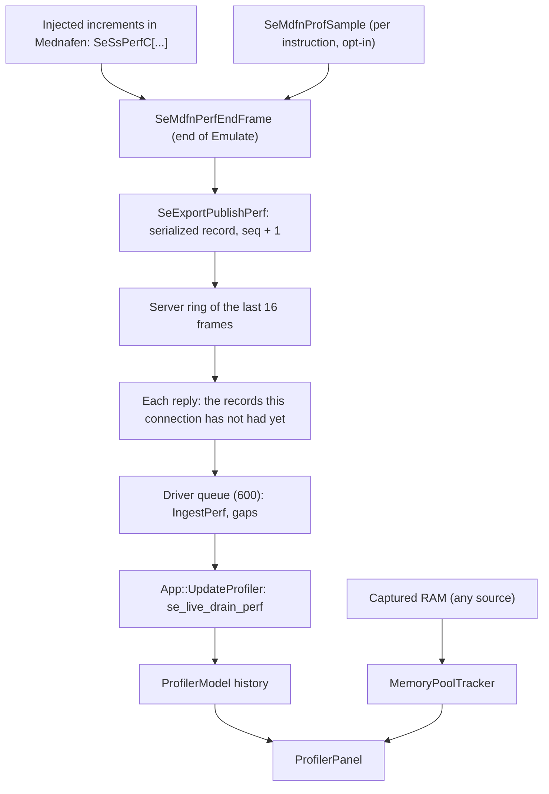

# Profiler

Inspected revision: the change that introduced it (protocol v26), on top of
`6491e73`, plus the v27 wire/counter freeze (Step 0 of [ProfilerFixPlan](../../ProfilerFixPlan.md)).
**v27 status:** the record layout and counter indices below are frozen; the fields the fix plan
has not filled yet are declared and carried but marked "not available" on the wire (a clear bit in
the record's `valid` word). Filled so far: frame identity and lost-record accounting (F3), the per-connection profiler request (F1), and
capability bits correct from the first reply (F14); the rest (F2, F4 to F9, F11) follow. Behavior below is verified from source and from the tests listed; the
emulator-side numbers have **not** been checked against a running game (see Coverage limits).

## Purpose and responsibilities

The Profiler panel answers three questions about a running Saturn game, in the manner of a
console performance analyzer:

- **Where does each frame's time go?** Both SH-2s (busy / stalled on the bus / asleep /
  switched off), VDP1 drawing, the SCU DSP and the 68000.
- **What crosses the buses?** SH-2 external-bus accesses per device, grouped into the CPU
  bus, A-bus and B-bus, and SCU DMA traffic per level and per bus-to-bus route.
- **How full are the memory pools?** The fixed RAMs (work RAM high/low, VDP1/VDP2 VRAM,
  colour RAM, sound RAM): how much holds data and what is being rewritten.

Optionally it also attributes SH-2 time to **functions** (self time).

It owns the counters, their wire block and the panel. It does not own the shadow call stack
(it reads it; see [Debugger](Debugger.md)), function naming (`FunctionNames`) or the live
transport (see [State sources](StateSources.md)).

## Source locations, types and entry points

| Responsibility | Source and important symbols |
|---|---|
| Counter indices and the function key (single source of truth for emulator, wire and client) | [SePerfCounters.h](../../../Integration/Common/SePerfCounters.h): `SE_PERF_*`, `SE_PERF_DEV_*`, `SE_PERF_FN_*` |
| Emulator instrumentation | [apply.py](../../../Integration/Mednafen/apply.py): `PERF_DECL`, `PERF_BUS_HELPER`, the `*_PERF_*` / `SH2_*` anchors, `process_profiler`; `SsDbgCpuTimestamp`, `SsDbgSetProfileActive` in `SS_ACCESSORS` |
| Frame hand-over and function sampling | [se_mednafen_glue.c](../../../Integration/Mednafen/se_mednafen_glue.c): `SeSsPerfC`, `SeMdfnPerfEndFrame`, `SeMdfnProfSample`, `SeMdfnSetProfiler` |
| Server | [se_export.c](../../../Integration/Common/se_export.c): `SeExportPublishPerf`, `SeExportBuildPerfSection` (a connection's reply section and its lost range), `SeExportFrameIdentity` / `SeIdReserve` / `SeExportEndFrame` (frame identity), `SeExportNotifyStateLoaded` (timeline), `SeExportPrepare` / `SeExportStart` (startup), `SeExportSetProfilerHook`, `SeExportSetPerfCapable`, `SeExportCurrentFunction`, `SePublishProfiler` |
| Wire contract | [SeLiveProtocol.h](../../../Integration/Common/SeLiveProtocol.h): `SE_LIVE_VERB_PROFILE`, `SE_LIVE_PROF_FUNCTIONS`, `SE_LIVE_CAP_PROFILER`, `SE_LIVE_CAP_PROF_FUNCTIONS`, "Perf section" |
| Client | [LiveDriver.cpp](../../../Drivers/Live/src/LiveDriver.cpp): `LivePerf`, the v26 and v27 parse in `ReadSnapshot`, `IngestPerf` (ordering, gaps, eviction); [LiveDriver.h](../../../Drivers/Live/src/LiveDriver.h): `se_live_perf_frame`, `se_live_drain_perf`, `se_live_perf_status_get`, `se_live_set_profiler` |
| Model (UI-free) | [ProfilerModel.h](../../../FrontEnd/src/Debug/ProfilerModel.h): `PerfFrame`, `ComputePerfShares`, `ComputeBusTotals`, `ProfilerModel` (ordering, `LostIn`, lost totals), `MemoryPoolTracker` |
| Panel | [ProfilerPanel.cpp](../../../FrontEnd/src/ProfilerPanel.cpp): `ProfilerPanel::Draw`, `Host` |
| App glue | [App.cpp](../../../FrontEnd/src/App.cpp): `App::UpdateProfiler`, `App::DrawProfiler`; registered in `App::PanelList` (Windows → Debugger → Profiler, hidden by default) |

## Execution flow



### Counters (always on)

The patch adds one 64-bit array, `SeSsPerfC`, and increments it where the work happens:

| Counter | Where it is counted |
|---|---|
| Frame length, slave-on time (v26 semantics; F2 integrates real on/off edges) | End of `Emulate()` (`end_ts`; the slave's timestamp reads `SS_EVENT_DISABLED_TS` while SMPC holds it off) |
| SH-2 sleep | The `SLEEP` op's idle step and `PSEUDO_STANDBY`, per CPU (`which`) |
| SH-2 bus stall | `PSEUDO_DMABURST` (DMA burst or external halt), per CPU |
| SH-2 bus accesses per device | `BSC_BusRead` / `BSC_BusWrite`, classified by a 64 KiB lookup table |
| VDP1 commands / starts / unfinished draws | the command fetch, `StartDrawing`, the frame-buffer-swap abort. The elapsed draw-cycle increment (index 6) is gone in v27 |
| VDP1 command-work cycles (55) | **F4.** `SeSsVdp1Debit(n)`, reached through a re-definition of `VDP1_EAT_CLOCKS(n)` inserted right after Mednafen's own: the debit `CycleCounter -= (n)` is where the command budget is spent, so this is work, not elapsed time. `n` is evaluated once (one use is the call that draws), and the counter moves before the resumable `case`, so a phase that yields and resumes is charged once. Excluded: the `HORRIBLEHACK_VDP1RWDRAWSLOWDOWN` debits `Write_CheckDrawSlowdown` / `Read_CheckDrawSlowdown` make for CPU access during a draw, and the budget a software `ENDR` leaves unspent. May exceed the frame (instant-draw mode); the model does not clamp it |
| VDP1 budget discarded by DMA (56) | **F4.** In `VDP1::Update`, the branch where `SCU_CheckVDP1HaltKludge()` says a DMA is writing VDP1 and the positive `CycleCounter` is zeroed: that value, only while `DrawingActive`. A budget quantity, not the elapsed time the DMA held VDP1 |
| SCU DSP cycles | **F11.** Two SH-2 clocks per dispatch of the scheduled loop in `SCU_UpdateDSP`. A manual control-register Step (`DSP.State == 0`, bit 17) runs one instruction outside the loop and is **excluded** |
| 68000 cycles (executed / total / idle) | **F5.** Idle: `M68K::InternalStep()` bumps a per-instance `IdleCycleCount` by the same 4 as `timestamp += 4` in the stopped / halted fall-through, after the reset, bus-error and interrupt branches have returned (so an interrupt-taking step is not idle). `SOUND_Update` takes the entry timestamp and idle baseline as `const` locals before `MDFN_setjmp` and both deltas once on its normal exit, so the four `MDFN_longjmp` paths in the sound bus handlers no longer skip them. Executed = total - idle |
| SCU DMA transfers and bytes per level and route | **F11.** `StartDMATransfer`, after its three refusals (illegal source, illegal destination, same bus): one count per transfer that started (an indirect chain starts one per table entry) and `bc`, the byte count it was started with ("requested", not moved: an aborted transfer is counted in full) |
| Bus accesses, dummy / unmapped (58..61) | **F8.** Same hook as the device buckets; see the bus table below |
| Cache mode | **F8.** `NeedEmuICache` -> `SeSsCacheMode` in `InitCommon`: `SE_PERF_CACHE_ON` when instruction fetches go through the emulated cache, `OFF` when the fast map serves them (the data cache is emulated in every mode) |

**Bus classification (F8).** The unit is a *request to the SH-2 bus state controller*: a 32-bit
access to a 16-bit CS0 region is split inside and is one request, a cache line fill is four
(one non-burst, three burst), a cache hit and a fast-map instruction fetch are none, and each
transfer unit of an SH-2 DMA channel is one read and one write. Counts therefore depend on the
cache mode, which travels with the sample. Address buckets (64 KiB steps, from the SCU decoder in
`scu.inc` and the CS0 decode in `ss.cpp`; `Integration/Mednafen/bus_decode.py` holds the table and
`check_component.py` checks the windows are still in the pinned source): A-bus CS0
`0x02000000-0x03FFFFFF`, CS1 `0x04000000-0x04FFFFFF`, **dummy** `0x05000000-0x057FFFFF`, CD
`0x05800000-0x058FFFFF`, **unmapped** `0x05900000-0x059FFFFF`, SCSP `0x05A00000-0x05BFFFFF`, VDP1
`0x05C00000-0x05D7FFFF`, **unmapped** `0x05D80000-0x05DFFFFF`, VDP2 `0x05E00000-0x05FBFFFF`,
**unmapped** `0x05FC0000-0x05FDFFFF`, SCU registers `0x05FE0000-0x05FEFFFF`, **unmapped**
`0x05FF0000-0x05FFFFFF`. The dummy and unmapped buckets are counters 58..61, kept out of the CPU /
A / B bus totals (`BusTotals::dummy*`, `unmapped*`). `CS0_OTHER` still lumps MINIT/SINIT with the
unmapped part of CS0.

The increments are unconditional: each sits on a path that already does far more work.
Every hook is an insertion (never a replacement), so `apply.py --revert` restores the files.

`SeMdfnPerfEndFrame` runs from `SeMednafenEndFrameHook`, hands the array to
`SeExportPublishPerf` when a client is attached, and zeroes it. The server numbers each
publication (`sampleSeq`, 64-bit, from 1 per exporter run) and keeps the last 16; every reply
carries the records its connection has not been sent yet, oldest first (at most
`SE_LIVE_PERF_MAX_PER_REPLY`). The records are a queue beside the snapshot, not part of it: a
client that is served a newer snapshot and skips one still receives every frame's counters, and a
paused or halted emulator sends none. A connection's first reply starts at the newest record (not
a loss); that decision is taken on the first reply whether or not it carries a record, so an
empty first reply does not later skip the early publications.

### Frame identity and lost records (F3)

- **Identity is the producer's.** The frame about to run has its number reserved at the
  top-of-frame gate (`SeGateRelease` -> `SeIdReserve`, after a pending load was applied and before
  the guest runs) and committed once by `SeExportEndFrame` when `Emulate()` completes. The glue
  stamps the perf record with `SeExportFrameIdentity` (`timelineId`, `frameNo`,
  `SE_PERF_VALID_IDENTITY`), so a frame with no snapshot (`NeedSoundReverse`) or with several
  debugger halts still reports its own number, and a record is never labelled with the snapshot
  frame of the reply that happened to carry it (`se_live_perf_frame.frame` is kept only for old
  callers). Ring/snapshot numbering is unchanged for ordinary execution; halt snapshots keep the
  last completed frame's number (a GET that has seen it must still receive the finished frame). A
  halt's ring number is a *delivery* number, never an identity: it does not reserve, rename or commit
  the frame it happens in. The first halt of a run (slot 0 means "empty") is delivered as 1, the
  number its frame will commit, so the frame's identity is the same before the halt, after it and in
  its record.
- **Timeline** changes on every replaced machine state, through one owner: an SE rewind or slot
  load (`SeStateAfterRestore`) and a native Mednafen load (`SeExportNotifyStateLoaded`, injected
  by `apply.py` after `CPU[1].PostStateLoad` in `StateAction`). A load the server ordered sets
  `sInSeLoad` around the emulator call, so its own `PostStateLoad` notification is not a second
  change; a failed load changes nothing. The first frame after a rewind to N is N+1. A native or
  slot load has no saved SE frame number: numbering continues from the counter it had (the
  documented origin); the timeline id tells the two apart.
- **Lost range, per connection.** The reply header carries `lostFirst..lostLast`: what the
  server's 16-deep ring overwrote before this connection was sent it, ending just before the
  reply's first record (or at the newest publication when the reply has none). One range per reply
  is sufficient; records merely deferred by the 8-per-reply cap are not lost.
  `SeExportBuildPerfSection` builds the section and is testable without a socket.
- **Driver.** `IngestPerf` orders records by the 64-bit `sampleSeq` (a v26 server's 32-bit `seq`
  is extended wrap-aware: a wrap is not a restart, going backwards is a duplicate). A range
  reported on a reply with no record becomes a *gap-only* queue entry (`gap_only`), in order, so it
  reaches the consumer; a newer `newestSeq` with nothing to carry it likewise, once. A jump the
  server did not report (an unreadable record, a v26 server) is inferred as a gap. When the 600
  entry queue evicts undrained records the new oldest entry carries the exact `evict_first..evict_last`
  range, separate from the server's `gap_first..gap_last` (these two are only the span to break the
  plot at; they merge separate losses into their enclosing interval, so a span can contain delivered
  records or overlap the other cause's span. The *number* of frames missing is `gap_count` (server)
  and `evict_count` (driver) on the record, exact and summed per cause, never derived from a span): the server never had it to give versus
  the application did not drain it. `se_live_perf_status_get` exposes `newest_seq`, `queued_seq`,
  a reply count and lost/evicted totals, so tests and panels can wait for "everything published has
  arrived" instead of sleeping.
- **Model.** `ProfilerModel::Push` orders by the 64-bit sequence (32-bit wrap-aware when absent),
  keeps gap-only ranges pending until the next frame, and exposes per-frame `HasGap()` (the plot
  breaks there), `TotalServerLost()` / `TotalDriverEvicted()`, and `LostIn(window)` so an
  averaging window can state how many frames it is missing.

### Wire record and counter layout (v27, frozen)

The authoritative text is the comment at "Perf section" in
[SeLiveProtocol.h](../../../Integration/Common/SeLiveProtocol.h) and the v26 to v27 table in
[SePerfCounters.h](../../../Integration/Common/SePerfCounters.h); this is the summary.

Section (all little-endian): `u32 count, u64 newestSeq, u64 lostFirst, u64 lostLast`, then per
record `u32 length` and

| Field | Notes |
|---|---|
| `u64 sampleSeq` | orders publications in one exporter run, never 0 |
| `u32 timelineId`, `u64 frameNo` | frame identity (F3); valid with `SE_PERF_VALID_IDENTITY` |
| `u32 mode` | attribution mode latched for the frame (F6); `SE_PERF_VALID_MODE` |
| `u32 cacheMode` | `SE_PERF_CACHE_*` (F8); `SE_PERF_VALID_CACHE` |
| `u32 valid` | `SE_PERF_VALID_*`: which v27-only fields the producer really filled |
| `u32 satFlags`, `u64 otherNotAdmitted[2]`, `u64 otherEvicted[2]` | per-CPU Other split (F7); `SE_PERF_VALID_OTHER` |
| `u32 counterCount`, `u64 counters[]` | 62 from a v27 server |
| `u32 fnCount`, `{u32 key, u32 cycles}[]`, `u32 fnOtherCycles` | as in v26 |

The lost range is the `sampleSeq` span the server dropped for this connection just before the
first record of the reply (`lostLast + 1` equals that record's `sampleSeq`); 0, 0 means none.

Counters: indices 0 to 53 keep their v26 meaning. Index 5 (slave on-cycles) keeps its index and
meaning (only its producer is corrected, F2). **Index 6 (v26: elapsed VDP1 drawing) is retired:
a v27 producer writes 0 and it is never reused.** Appended: 54 slave on-cycles integrated (F2),
55 VDP1 command-work cycles, 56 VDP1 budget discarded by DMA (F4), 57 68000 idle cycles (F5),
58 to 61 A-bus dummy and unmapped bus buckets, `[xdev * 2 + write]` (F8).

Version handling: the driver reads both forms by the negotiated server version. A v26 record is
presented with `wire_version == 26` (and no `valid` bit): counter 6 is
the old figure, shown under its old label ("VDP1 drawing"), and identity, mode, cache mode, the
Other split and every v27-only counter are "not available". A v27 record is shown as "VDP1
command work", and as "not available" until `SE_PERF_VALID_VDP1_WORK` is set. A v26 client
rejects a v27 server at its version check (a v25 client already rejects v26): update emulator and
app together.

Capability bits (documented in `SeLiveProtocol.h`), both correct in the very first reply (F14):
`SE_LIVE_CAP_PROFILER` means counters are produced, declared at startup with
`SeExportSetPerfCapable` (not inferred from the first publication); `SE_LIVE_CAP_PROF_FUNCTIONS`
means the per-instruction hook exists, so a build without debugger support advertises only the
first.

Startup order (F14): `SeMednafenFrameHook` calls `SeExportPrepare` (locks and state, server marked
running so the savestate worker can start), registers every hook and the counter capability, and
only then `SeExportStart` admits listeners. Moving registration before init would not work:
`SeStateStartWorker` returns while `sRunning` is false, silently disabling rewind. `SeExportInit` is
Prepare + Start for callers with nothing to register; a deinit/init cycle clears the profiler
records, sequence, declared capabilities and the profiler hook.

### Function attribution (opt-in)

`SE_LIVE_PROF_FUNCTIONS` (the `PRF` verb) makes `SeSyncCpuHook` keep the continuous
per-instruction callback installed, exactly as a tracepoint does. That selects Mednafen's
debug run loop, which is several times slower, so:

- the client sends it only while the panel is open with the checkbox ticked
  (`App::UpdateProfiler` restates the setting every frame; the driver sends changes);
- **the request belongs to the connection (F1).** `SeServeClient` (common to the POSIX local
  socket, the TCP/web-bridge listener and the Windows pipe) takes a slot (`SeProfAcquire`) for the
  connection's lifetime and releases it (`SeProfRelease`) on every way out of the serve loop. The
  PRF verb sets that slot (`SeProfSetRequest`); under `SE_LOCK` every join, change or leave
  recomputes `sProfWanted`, the OR of all slots, and marks it pending. Only the emulate thread
  applies it (`SeApplyPendingInstalls`) and publishes the result in `sProfApplied`
  (`SeExportProfilerFlags()`), the single value the emulator runs with. So one client's request
  neither leaks to a second client nor outlives its connection, and the last-client cleanup
  (`SeOnClientDisconnect`) no longer writes the request at all, so it cannot clobber a newer
  client's. At most 8 connections hold a slot; one beyond that cannot request;
- a new connection starts with no request, whatever the previous one said, and the driver restates
  its setting on every new connection, **off included** (`profDirty = true` on connect);
- it needs `--enable-debugger`; otherwise no hook is registered and the capability bit is
  clear, and the panel disables the checkbox.

Per instruction, `SeMdfnProfSample` charges the cycles since that CPU's previous
instruction, minus the sleep/stall cycles counted in between, to the function the previous
instruction was in. The function is the innermost shadow-call-stack frame's entry
(`SeExportCurrentFunction`); with no recorded frame (code already running when profiling
began, e.g. the main loop) the key is a 16-byte bucket of the raw PC, flagged
`SE_PERF_FN_RAW_PC`. A per-frame hash table collects the keys; the 64 hottest go on the
wire and the rest are summed into `fn_other_cycles`.

### Memory pools

Not an emulator feature: `MemoryPoolTracker` reads the captured regions through
`ContextBackend`, so it works for savestates and scrubbed frames too. Each pool is split
into at most 1024 blocks; a block that is one byte value repeated is *empty*, anything else
*holds data*, and a block whose hash differs from the previous sample is *rewritten* (the
mark fades over later samples). Sampling runs only while the Memory tab is showing, every
tenth UI frame. This is occupancy of the fixed RAMs, not a view of any game's heap
allocator, which the hardware knows nothing about.

## State, ownership and invalidation

- `SeSsPerfC` and the sampling table are written by the emulate thread only.
- `sPerfBlk` (the server's record ring) is guarded by `SE_LOCK`; `perfSent`, the newest
  frame a connection has been sent, is local to that connection's serving loop, so the
  local-socket and TCP clients each get every frame.
- The driver's perf queue (records and gap-only entries), its sequence cursor, the pending lost
  range and the totals are guarded by `ctlMtx`, bounded at 600 entries, and reset on a new
  connection.
- `ProfilerModel` is UI-thread state. It is cleared on `CloseData`, on
  `AdoptNewEmulatorInstance`, by the panel's Clear button, and by a sequence that goes
  backwards (a new emulator run).
- Frame identity state (`sIdFrame`, `sIdOpen`, `sFrameNo`) is the emulate thread's; `sTimelineId`
  is atomic.

## Extension points and constraints

| Task | Start here; preserve |
|---|---|
| Add a counter | Append to `SePerfCounters.h` (never reorder), add the increment as an anchored insertion in `apply.py`, read it in `ComputePerfShares` / the panel. Older clients ignore surplus counters; older servers leave new ones zero |
| Add an emulator | Fill an array in `SePerfCounters.h` order and call `SeExportPublishPerf` once per frame; register `SeExportSetProfilerHook` only if a per-instruction hook exists |
| Change a record | Each states its own length: append fields, keep the existing order |
| Inclusive (caller) time, per-scanline timelines | Not implemented; see Coverage limits |

## Testing

```sh
ctest --test-dir build --output-on-failure -R 'ProfilerModel|ProfilerPanel|LiveProfiler|MednafenRoundTrip'
```

- [ProfilerModelTests.cpp](../../../FrontEnd/tests/ProfilerModelTests.cpp): share arithmetic
  and clamping, bus grouping, history window and de-duplication, function totals, pool
  classification.
- [ProfilerPanelTests.cpp](../../../FrontEnd/tests/ProfilerPanelTests.cpp): the panel drawn
  headlessly; drawn figures, tab-driven data requests, disabled attribution, row
  double-click through a row with a hoverable bar.
- [LiveProfilerTests.cpp](../../../FrontEnd/tests/LiveProfilerTests.cpp): real exporter and
  real driver, in lockstep (the producer never gets ahead of what the driver has queued, judged
  by `se_live_perf_status_get`, never by sleeping); every frame once, intact and gap-free from the
  first publication, `PRF` reaching the emulate-thread hook, and attribution dropped on disconnect.
- [LivePerfLossTests.cpp](../../../FrontEnd/tests/LivePerfLossTests.cpp): the section builder
  (empty and non-empty first replies, exact ring-overrun range, crossing 2^32, deinit/init), the
  driver against a scripted server (gap-only replies, server loss kept apart from driver eviction,
  32- and 64-bit sequences), the capability bits of the first reply with and without a debugger,
  and identity end to end (batch, no snapshot, native load, slot load once, refused load, reconnect,
  several halts in a frame).
- [LiveProfilerRequestTests.cpp](../../../FrontEnd/tests/LiveProfilerRequestTests.cpp): F1. Real
  exporter and two real drivers at once (local socket and TCP, own socket and port): A requests, B
  does not; A leaves (and is reset abruptly) while B stays; both request and one leaves; repeated
  connect-enable-leave; the TCP listener's lifetime. Plus the driver against a scripted server:
  the setting, "off" included, is restated on every reconnect.
- [MemoryRoundTripTests.cpp](../../../FrontEnd/tests/MemoryRoundTripTests.cpp) (profiler
  section): the real glue, in lockstep with the client; counters handed over and zeroed per
  frame with consecutive producer-stamped frame numbers, a rewind starting a new timeline, and
  `SeMdfnProfSample` charging cycles to a recorded function, to a raw-PC bucket, per CPU,
  less sleep, and not across a timestamp jump.
- The panel was also run in the native frontend against a stand-in emulator (the real
  export server fed synthetic counters) and inspected on all four tabs.

## Coverage limits

- The patched Mednafen 1.32.1 was **compiled and linked** with these hooks
  (`--enable-debugger`); it was not run with a game, so the magnitudes of the counters
  have not been compared with known workloads. Verify on a real title before relying on
  absolute numbers.
- "Busy" includes time an SH-2 spends waiting on slow bus cycles; only SLEEP/standby and
  DMA-burst/external-halt stalls are separated out.
- Bus accesses are bus-controller requests (see "Bus classification"): cache hits and
  fast-map instruction fetches are not counted, and the number depends on the cache mode.
- DMA bytes are the counts transfers were *started* with; an aborted transfer is counted
  in full. A manual DSP step is not in the DSP figure.
- VDP1 command work leaves out the draw slowdown the `VDP1RWDRAWSLOWDOWN` hack charges for CPU
  access to VDP1 memory during a draw, and what a software `ENDR` leaves unspent. The F4/F5
  component tests drive the real patched `vdp1.cpp`, `m68k.cpp` and `sound.cpp`, but the counter
  magnitudes on a real game are still unverified (V1/V2 need a BIOS).
- Function time is self time only, and the raw-PC buckets are not folded into functions
  (`ProfilerPanel::Host::functionContaining` is an unfilled hook for the function finder).
- VDP2 has no time figure: its raster is fixed-length.

## Related documentation

[Knowledge-base index](../README.md), [State sources](StateSources.md),
[Debugger](Debugger.md), [Mednafen integration](../../../Integration/Mednafen/README.md).
