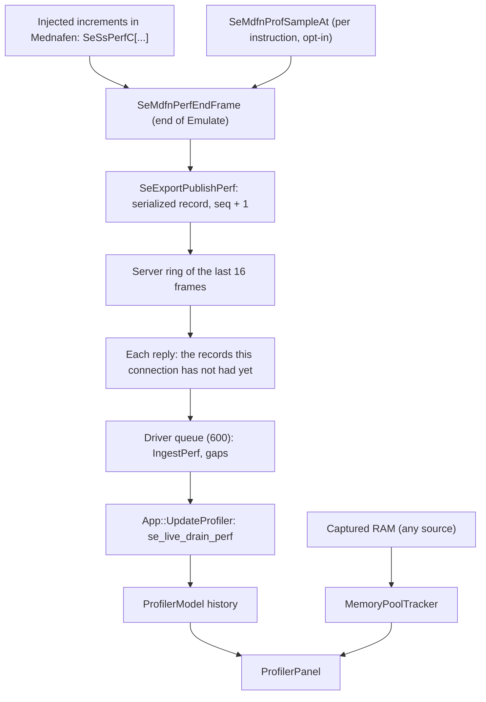

# Profiler

Inspected revision: the change that introduced it (protocol v26), on top of
`6491e73`, plus the v27 wire/counter freeze (Step 0 of [ProfilerFixPlan](../../ProfilerFixPlan.md)).
**v27 status:** the record layout and counter indices below are frozen; the fields the fix plan
has not filled yet are declared and carried but marked "not available" on the wire (a clear bit in
the record's `valid` word). Filled so far: frame identity and lost-record accounting (F3), the per-connection
profiler request (F1), capability bits correct from the first reply (F14), the VDP1, 68000, bus and DMA/DSP
hooks (F4, F5, F8, F11), the slave on-time and the latched mode (F2 + F6, one frame-lifecycle contract), and
function ownership (F9), and, on the front end, the per-CPU Other, the window-validity rule, the labels and the Memory tab (F7, F10, review finding P2); the v27 plan has nothing left unfilled. Behavior below is verified from source and from the tests listed; the
emulator-side numbers have **not** been checked against a running game (see Coverage limits).

## Purpose and responsibilities

The Profiler panel answers three questions about a running Saturn game, in the manner of a
console performance analyzer:

- **Where does each frame's time go?** Both SH-2s (busy / stalled on the bus / asleep /
  switched off), VDP1 drawing, the SCU DSP and the 68000.
- **What crosses the buses?** SH-2 external-bus accesses per device, grouped into the CPU
  bus, A-bus and B-bus, and SCU DMA traffic per level and per bus-to-bus route.
- **How full are the memory pools?** The fixed RAMs (work RAM high/low, VDP1/VDP2 VRAM,
  colour RAM, sound RAM): how much holds data and what is being rewritten.

Optionally it also attributes SH-2 time to **functions** (self time).

It owns the counters, their wire block and the panel. It does not own the shadow call stack
(it reads it; see [Debugger](Debugger.md)), function naming (`FunctionNames`) or the live
transport (see [State sources](StateSources.md)).

## Source locations, types and entry points

| Responsibility | Source and important symbols |
|---|---|
| Counter indices and the function key (single source of truth for emulator, wire and client) | [SePerfCounters.h](../../../Integration/Common/SePerfCounters.h): `SE_PERF_*`, `SE_PERF_DEV_*`, `SE_PERF_FN_*` |
| Emulator instrumentation | [apply.py](../../../Integration/Mednafen/apply.py): `PERF_DECL`, `PERF_BUS_HELPER`, the `*_PERF_*` / `SH2_*` anchors, `process_profiler`; `SsDbgCpuTimestamp`, `SsDbgSetProfileActive` in `SS_ACCESSORS` |
| Frame hand-over and function sampling | [se_mednafen_glue.c](../../../Integration/Mednafen/se_mednafen_glue.c): `SeSsPerfC`, `SeMdfnPerfEndFrame`, `SeMdfnProfSampleAt`, `SeMdfnApplyMode`, the lifecycle entry points `SeMednafenSlaveActive` / `CpuReset` / `ExceptionEntry` / `StateLoaded` / `FrameClose` |
| Server | [se_export.c](../../../Integration/Common/se_export.c): `SeExportPublishPerf`, `SeExportBuildPerfSection` (a connection's reply section and its lost range), `SeExportFrameIdentity` / `SeIdReserve` / `SeExportEndFrame` (frame identity), `SeExportNotifyStateLoaded` (timeline), `SeExportPrepare` / `SeExportStart` (startup), `SeExportSetProfilerHook`, `SeExportSetPerfCapable`, `SeExportCurrentFunction`, `SePublishProfiler` |
| Wire contract | [SeLiveProtocol.h](../../../Integration/Common/SeLiveProtocol.h): `SE_LIVE_VERB_PROFILE`, `SE_LIVE_PROF_FUNCTIONS`, `SE_LIVE_CAP_PROFILER`, `SE_LIVE_CAP_PROF_FUNCTIONS`, "Perf section" |
| Client | [LiveDriver.cpp](../../../Drivers/Live/src/LiveDriver.cpp): `LivePerf`, the v26 and v27 parse in `ReadSnapshot`, `IngestPerf` (ordering, gaps, eviction); [LiveDriver.h](../../../Drivers/Live/src/LiveDriver.h): `se_live_perf_frame`, `se_live_drain_perf`, `se_live_perf_status_get`, `se_live_set_profiler` |
| Model (UI-free) | [ProfilerModel.h](../../../FrontEnd/src/Debug/ProfilerModel.h): `PerfFrame`, `ComputePerfShares`, `ComputeBusTotals`, `ProfilerModel` (ordering, `LostIn`, lost totals, `Shares` / `WindowShares` / `Coverage`, `Functions` / `FunctionWindow`, `LatestIdentity`), `SplitHistoryRuns`, `PerfFrameLabel`, `MemoryPoolTracker` (`SetSource`) |
| Panel | [ProfilerPanel.cpp](../../../FrontEnd/src/ProfilerPanel.cpp): `ProfilerPanel::Draw`, `Host` |
| App glue | [App.cpp](../../../FrontEnd/src/App.cpp): `App::UpdateProfiler`, `App::DrawProfiler`; registered in `App::PanelList` (Windows → Debugger → Profiler, hidden by default) |

## Execution flow



### Counters (always on)

The patch adds one 64-bit array, `SeSsPerfC`, and increments it where the work happens:

| Counter | Where it is counted |
|---|---|
| Frame length | End of `Emulate()` (`end_ts`) |
| Slave on-time (index 5, **F2**) | Integrated over the slave's real power edges, see "Frame lifecycle" below. `SeMednafenFrameClose`, called before the rebase |
| SH-2 sleep | The `SLEEP` op's idle step and `PSEUDO_STANDBY`, per CPU (`which`) |
| SH-2 bus stall | `PSEUDO_DMABURST` (DMA burst or external halt), per CPU |
| SH-2 bus accesses per device | `BSC_BusRead` / `BSC_BusWrite`, classified by a 64 KiB lookup table |
| VDP1 commands / starts / unfinished draws | the command fetch, `StartDrawing`, the frame-buffer-swap abort. The elapsed draw-cycle increment (index 6) is gone in v27 |
| VDP1 command-work cycles (55) | **F4.** `SeSsVdp1Debit(n)`, reached through a re-definition of `VDP1_EAT_CLOCKS(n)` inserted right after Mednafen's own: the debit `CycleCounter -= (n)` is where the command budget is spent, so this is work, not elapsed time. `n` is evaluated once (one use is the call that draws), and the counter moves before the resumable `case`, so a phase that yields and resumes is charged once. Excluded: the `HORRIBLEHACK_VDP1RWDRAWSLOWDOWN` debits `Write_CheckDrawSlowdown` / `Read_CheckDrawSlowdown` make for CPU access during a draw, and the budget a software `ENDR` leaves unspent. May exceed the frame (instant-draw mode); the model does not clamp it |
| VDP1 budget discarded by DMA (56) | **F4.** In `VDP1::Update`, the branch where `SCU_CheckVDP1HaltKludge()` says a DMA is writing VDP1 and the positive `CycleCounter` is zeroed: that value, only while `DrawingActive`. A budget quantity, not the elapsed time the DMA held VDP1 |
| SCU DSP cycles | **F11.** Two SH-2 clocks per dispatch of the scheduled loop in `SCU_UpdateDSP`. A manual control-register Step (`DSP.State == 0`, bit 17) runs one instruction outside the loop and is **excluded** |
| 68000 cycles (executed / total / idle) | **F5.** Idle: `M68K::InternalStep()` bumps a per-instance `IdleCycleCount` by the same 4 as `timestamp += 4` in the stopped / halted fall-through, after the reset, bus-error and interrupt branches have returned (so an interrupt-taking step is not idle). `SOUND_Update` takes the entry timestamp and idle baseline as `const` locals before `MDFN_setjmp` and both deltas once on its normal exit, so the four `MDFN_longjmp` paths in the sound bus handlers no longer skip them. Executed = total - idle |
| SCU DMA transfers and bytes per level and route | **F11.** `StartDMATransfer`, after its three refusals (illegal source, illegal destination, same bus): one count per transfer that started (an indirect chain starts one per table entry) and `bc`, the byte count it was started with ("requested", not moved: an aborted transfer is counted in full) |
| Bus accesses, dummy / unmapped (58..61) | **F8.** Same hook as the device buckets; see the bus table below |
| Cache mode | **F8.** `NeedEmuICache` -> `SeSsCacheMode` in `InitCommon`: `SE_PERF_CACHE_ON` when instruction fetches go through the emulated cache, `OFF` when the fast map serves them (the data cache is emulated in every mode) |

**Bus classification (F8).** The unit is a *request to the SH-2 bus state controller*: a 32-bit
access to a 16-bit CS0 region is split inside and is one request, a cache line fill is four
(one non-burst, three burst), a cache hit and a fast-map instruction fetch are none, and each
transfer unit of an SH-2 DMA channel is one read and one write. Counts therefore depend on the
cache mode, which travels with the sample. Address buckets (64 KiB steps, from the SCU decoder in
`scu.inc` and the CS0 decode in `ss.cpp`; `Integration/Mednafen/bus_decode.py` holds the table and
`check_component.py` checks the windows are still in the pinned source): A-bus CS0
`0x02000000-0x03FFFFFF`, CS1 `0x04000000-0x04FFFFFF`, **dummy** `0x05000000-0x057FFFFF`, CD
`0x05800000-0x058FFFFF`, **unmapped** `0x05900000-0x059FFFFF`, SCSP `0x05A00000-0x05BFFFFF`, VDP1
`0x05C00000-0x05D7FFFF`, **unmapped** `0x05D80000-0x05DFFFFF`, VDP2 `0x05E00000-0x05FBFFFF`,
**unmapped** `0x05FC0000-0x05FDFFFF`, SCU registers `0x05FE0000-0x05FEFFFF`, **unmapped**
`0x05FF0000-0x05FFFFFF`. The dummy and unmapped buckets are counters 58..61, kept out of the CPU /
A / B bus totals (`BusTotals::dummy*`, `unmapped*`). `CS0_OTHER` still lumps MINIT/SINIT with the
unmapped part of CS0.

**Tested counts (cache fills, SH-2 DMAC).** [BUS_EXPECTED.md](../../../Integration/Mednafen/component/BUS_EXPECTED.md)
derives them from the patched source and `perf_bus_harness.cpp` asserts them exactly on the real core:
a cached miss is **4** requests (1 + 3 burst, whatever the access size or device, instruction or data), a
hit and the associative-purge / array / on-chip spaces are **0**, a cache-through (`0x2xxxxxxx`) read is 1,
`CCR.OD` (data) / `CCR.ID` (instruction and PC-relative reads) turn a miss into a single uncached read, a
purge (`CCR.CP` or associative) makes the next read refill, and a write is always exactly 1. With the
instruction cache not emulated (`SE_PERF_CACHE_OFF`) fetches cost 0; emulated, 4 per line filled (CE) or 1
per 32-bit word (CE clear / ID). The DMAC does one read on the source and one write on the destination
per unit for 8/16/32-bit units (burst and cycle-steal identical), crossing devices and the dummy /
unmapped buckets as expected; the 16-byte mode reads in batches of 4 (K not a multiple of 4 over-reads:
reads = 4 x ceil(K/4), writes = K), and an address error stops the channel after the unit in flight.

The increments are unconditional: each sits on a path that already does far more work.
Every hook is an insertion, except the `smpc.cpp` input call, which keeps the upstream line inside its fence; `apply.py --revert` restores every file byte for byte.

`SeMdfnPerfEndFrame` runs from `SeMednafenEndFrameHook`, hands the array to
`SeExportPublishPerf` when a client is attached, and zeroes it. The server numbers each
publication (`sampleSeq`, 64-bit, from 1 per exporter run) and keeps the last 16; every reply
carries the records its connection has not been sent yet, oldest first (at most
`SE_LIVE_PERF_MAX_PER_REPLY`). The records are a queue beside the snapshot, not part of it: a
client that is served a newer snapshot and skips one still receives every frame's counters, and a
paused or halted emulator sends none. A connection's first reply starts at the newest record (not
a loss); that decision is taken on the first reply whether or not it carries a record, so an
empty first reply does not later skip the early publications.

### Frame identity and lost records (F3)

- **Identity is the producer's.** The frame about to run has its number reserved at the
  top-of-frame gate (`SeGateRelease` -> `SeIdReserve`, after a pending load was applied and before
  the guest runs) and committed once by `SeExportEndFrame` when `Emulate()` completes. The glue
  stamps the perf record with `SeExportFrameIdentity` (`timelineId`, `frameNo`,
  `SE_PERF_VALID_IDENTITY`), so a frame with no snapshot (`NeedSoundReverse`) or with several
  debugger halts still reports its own number, and a record is never labelled with the snapshot
  frame of the reply that happened to carry it (`se_live_perf_frame.frame` is kept only for old
  callers). Ring/snapshot numbering is unchanged for ordinary execution; halt snapshots keep the
  last completed frame's number. A halt never reserves, renames or commits the frame it happens in;
  the first halt of a run (slot 0 means "empty") shows 1, the number its frame will commit, so the
  frame's identity is the same before the halt, after it and in its record.
- **Three different numbers.**
  1. The *reserved perf identity* (`SeIdReserve`, `SeExportFrameIdentity`, committed once in
     `SeExportEndFrame`): the frame under execution; halts never touch it.
  2. The *committed* `sFrameNo` (0 before the first frame completes). It is what the reply header's
     frame field shows for a normal snapshot, and what event / call-frame / trace stamps
     (`sEvQ[].frame`, `SeCallFrame.frameNo`) read at the moment they are produced. So those stamps
     are 0, or the previous frame's number, for anything produced before the frame in progress
     commits -- notably everything before the first normal snapshot or end of frame, which includes
     a first halt. They are display hints, never keys. Audited consumers: the Log panel shows 0 as
     "-", the Call Stack panel prints "recorded: cycle, frame" only when the cycle or frame is
     nonzero, a tracepoint's `frame` format/condition variable (`App.cpp` ContextFormat) just reads 0; none treats 0 as an error.
  3. The snapshot *delivery sequence* (`sRingSeq`, `sDeliverySeq`): every snapshot written to the
     ring, halt or normal, takes the next number of one strictly monotonic 64-bit counter (reset only
     by `SeExportInit`, not by a restore). A GET is served the OLDEST slot whose delivery number is
     newer than the one this connection was last served. The server keeps that cursor per connection
     (last served delivery number, the frame number it showed, the ring epoch). The cursor is trusted
     when the GET's arg equals the frame number the connection was last served (which is what the
     driver sends), or when a restore has emptied the ring since (the arg is then a resync to the
     load's frame, and everything in the ring is newer). Otherwise (a client naming some other frame,
     a fresh connection) the old rule applies: a slot is unseen when its frame number exceeds the arg,
     served oldest first by delivery order.
  The reply header carries only the emulated frame number (the wire layout is unchanged, no version
  bump): the delivery sequence is server-side. Mapping: each ring slot holds (delivery number, frame
  number); a normal snapshot's frame is the frame it was reserved, a halt's is the last committed
  frame (1 before any). Rewind targets, step completion, the recorder and the on-screen frame number
  therefore keep meaning the emulated frame; a rewind to N still makes N+1 the next frame. Two
  snapshots may show the same frame number (a halt and the frame it is inside) and are still two
  deliveries. Consequence: every halt snapshot is now delivered in order to a client that polls,
  instead of only the latest being re-served.
- **Timeline** changes on every replaced machine state, through one owner: an SE rewind or slot
  load (`SeStateAfterRestore`) and a native Mednafen load (`SeExportNotifyStateLoaded`, injected
  by `apply.py` after `CPU[1].PostStateLoad` in `StateAction`). A load the server ordered sets
  `sInSeLoad` around the emulator call, so its own `PostStateLoad` notification is not a second
  change; a failed load changes nothing. The first frame after a rewind to N is N+1. A native or
  slot load has no saved SE frame number: numbering continues from the counter it had (the
  documented origin); the timeline id tells the two apart.
- **Lost range, per connection.** The reply header carries `lostFirst..lostLast`: what the
  server's 16-deep ring overwrote before this connection was sent it, ending just before the
  reply's first record (or at the newest publication when the reply has none). One range per reply
  is sufficient; records merely deferred by the 8-per-reply cap are not lost.
  `SeExportBuildPerfSection` builds the section and is testable without a socket.
- **Driver.** `IngestPerf` orders records by the 64-bit `sampleSeq` (a v26 server's 32-bit `seq`
  is extended wrap-aware: a wrap is not a restart, going backwards is a duplicate). A range
  reported on a reply with no record becomes a *gap-only* queue entry (`gap_only`), in order, so it
  reaches the consumer; a newer `newestSeq` with nothing to carry it likewise, once. A jump the
  server did not report (an unreadable record, a v26 server) is inferred as a gap. When the 600
  entry queue evicts undrained records the new oldest entry carries the exact `evict_first..evict_last`
  range, separate from the server's `gap_first..gap_last` (these two are only the span to break the
  plot at; they merge separate losses into their enclosing interval, so a span can contain delivered
  records or overlap the other cause's span. The *number* of frames missing is `gap_count` (server)
  and `evict_count` (driver) on the record, exact and summed per cause, never derived from a span): the server never had it to give versus
  the application did not drain it. `se_live_perf_status_get` exposes `newest_seq`, `queued_seq`,
  a reply count and lost/evicted totals, so tests and panels can wait for "everything published has
  arrived" instead of sleeping.
- **Model.** `ProfilerModel::Push` orders by the 64-bit sequence (32-bit wrap-aware when absent),
  keeps gap-only ranges pending until the next frame, and exposes per-frame `HasGap()` (the plot
  breaks there), `TotalServerLost()` / `TotalDriverEvicted()`, and `LostIn(window)` so an
  averaging window can state how many frames it is missing.

### Wire record and counter layout (v27, frozen)

The authoritative text is the comment at "Perf section" in
[SeLiveProtocol.h](../../../Integration/Common/SeLiveProtocol.h) and the v26 to v27 table in
[SePerfCounters.h](../../../Integration/Common/SePerfCounters.h); this is the summary.

Section (all little-endian): `u32 count, u64 newestSeq, u64 lostFirst, u64 lostLast`, then per
record `u32 length` and

| Field | Notes |
|---|---|
| `u64 sampleSeq` | orders publications in one exporter run, never 0 |
| `u32 timelineId`, `u64 frameNo` | frame identity (F3); valid with `SE_PERF_VALID_IDENTITY` |
| `u32 mode` | attribution mode the frame ran in, latched (F6, `sFrameMode`); `SE_PERF_VALID_MODE` |
| `u32 cacheMode` | `SE_PERF_CACHE_*` (F8); `SE_PERF_VALID_CACHE` |
| `u32 valid` | `SE_PERF_VALID_*`: which v27-only fields the producer really filled |
| `u32 satFlags`, `u64 otherNotAdmitted[2]`, `u64 otherEvicted[2]` | per-CPU Other split (F7); `SE_PERF_VALID_OTHER` |
| `u32 counterCount`, `u64 counters[]` | 62 from a v27 server |
| `u32 fnCount`, `{u32 key, u32 cycles}[]`, `u32 fnOtherCycles` | as in v26 |

The lost range is the `sampleSeq` span the server dropped for this connection just before the
first record of the reply (`lostLast + 1` equals that record's `sampleSeq`); 0, 0 means none.

Counters: indices 0 to 53 keep their v26 meaning. Index 5 (slave on-cycles) keeps its index and
meaning; only its producer is corrected (F2), and `SE_PERF_VALID_SSH2_INT` says index 5 is the
integrated figure. **Index 6 (v26: elapsed VDP1 drawing) is retired: a v27 producer writes 0 and it
is never reused. Index 54 is reserved (`SE_PERF_RESERVED_54`): it is never produced, since a second
copy of index 5 could only disagree with it.** Appended: 55 VDP1 command-work cycles, 56 VDP1 budget discarded by DMA (F4), 57 68000 idle cycles (F5),
58 to 61 A-bus dummy and unmapped bus buckets, `[xdev * 2 + write]` (F8).

Version handling: the driver reads both forms by the negotiated server version. A v26 record is
presented with `wire_version == 26` (and no `valid` bit): counter 6 is
the old figure, shown under its old label ("VDP1 drawing"), and identity, mode, cache mode, the
Other split and every v27-only counter are "not available". A v27 record is shown as "VDP1
command work", and as "not available" until `SE_PERF_VALID_VDP1_WORK` is set. A v26 client
rejects a v27 server at its version check (a v25 client already rejects v26): update emulator and
app together.

Capability bits (documented in `SeLiveProtocol.h`), both correct in the very first reply (F14):
`SE_LIVE_CAP_PROFILER` means counters are produced, declared at startup with
`SeExportSetPerfCapable` (not inferred from the first publication); `SE_LIVE_CAP_PROF_FUNCTIONS`
means the per-instruction hook exists, so a build without debugger support advertises only the
first.

Startup order (F14): `SeMednafenFrameHook` calls `SeExportPrepare` (locks and state, server marked
running so the savestate worker can start), registers every hook and the counter capability, and
only then `SeExportStart` admits listeners. Moving registration before init would not work:
`SeStateStartWorker` returns while `sRunning` is false, silently disabling rewind. `SeExportInit` is
Prepare + Start for callers with nothing to register; a deinit/init cycle clears the profiler
records, sequence, declared capabilities and the profiler hook.

### Function attribution (opt-in)

`SE_LIVE_PROF_FUNCTIONS` (the `PRF` verb) makes `SeSyncCpuHook` keep the continuous
per-instruction callback installed, exactly as a tracepoint does. That selects Mednafen's
debug run loop, which is several times slower, so:

- the client sends it only while the panel is open with the checkbox ticked
  (`App::UpdateProfiler` restates the setting every frame; the driver sends changes);
- **the request belongs to the connection (F1).** `SeServeClient` (common to the POSIX local
  socket, the TCP/web-bridge listener and the Windows pipe) takes a slot (`SeProfAcquire`) for the
  connection's lifetime and releases it (`SeProfRelease`) on every way out of the serve loop. The
  PRF verb sets that slot (`SeProfSetRequest`); under `SE_LOCK` every join, change or leave
  recomputes `sProfWanted`, the OR of all slots, and marks it pending. Only the emulate thread
  applies it (`SeApplyPendingInstalls`) and publishes the result in `sProfApplied`
  (`SeExportProfilerFlags()`), the single value the emulator runs with. So one client's request
  neither leaks to a second client nor outlives its connection, and the last-client cleanup
  (`SeOnClientDisconnect`) no longer writes the request at all, so it cannot clobber a newer
  client's. At most 8 connections hold a slot; one beyond that cannot request;
- a new connection starts with no request, whatever the previous one said, and the driver restates
  its setting on every new connection, **off included** (`profDirty = true` on connect);
- it needs `--enable-debugger`; otherwise no hook is registered and the capability bit is
  clear, and the panel disables the checkbox.

Per instruction, `SeMdfnProfSampleAt` charges the cycles since that CPU's previous
instruction, minus the sleep/stall cycles counted in between, to the function the previous
instruction was in. The function is the innermost shadow-call-stack frame's entry
(`SeExportCurrentFunction`) **while ownership is known (F9)**; otherwise (code already running when
profiling began, an interrupt handler, the body after a computed jump, a parent we never saw) the
key is a 16-byte bucket of the raw PC, flagged `SE_PERF_FN_RAW_PC`. A per-frame hash table collects
the keys; the 64 hottest go on the wire and the rest are summed into `fn_other_cycles`.

### Function ownership (F9)

The shadow stack records calls and returns; whether its innermost frame names the code that is
*executing* is a separate fact, kept per CPU in `se_export.c` (`sOwnKnown`, `sOwnTrust`, and per frame
`parentKnown` / `trust`). `SeExportCurrentFunction` returns 0, so the profiler charges the raw-PC
bucket, while ownership is unknown.

| Event | Ownership afterwards |
|---|---|
| Observed call (`bsr` / `bsrf` / `jsr`, observed `trapa`) | Known: the callee's entry is the function now running. The frame remembers whether its parent was known |
| Return (`rts` / `rte`) landing on the frame's recorded return address, from a frame whose parent was known and that was pushed since observation was last lost | Known: the parent is named again |
| Any other return: the parent was unknown (a call made from unknown code), the landing address is not the recorded one, the frame predates a loss of observation, or there was no frame | Unknown |
| Actual exception entry (interrupt, NMI, address error, illegal instruction: hooks in `sh7095_ops.inc`; **not** `trapa`, which is observed) | Unknown. The stack is kept, since a balanced handler returns through it |
| A call whose target is not where execution arrived (an interrupt came between the call and the callee's first instruction) | Unknown |
| Completed unconditional jump (`bra`, `jmp @Rn`, `braf Rn`), owner known, innermost frame a call frame | By where it landed, see "Unconditional jumps" below: a known entry transfers the frame to that function (tail call), an address the owner already ran or a forward move out of a function still inside its body keeps it, anything else is unknown until a call or a matching return proves it. Owner unknown, or the landing is not the jump's own target (an interrupt came between): unknown |
| Loss of continuous observation (profiler toggled, `SeMednafenHookMode(0)`) | Unknown, and every frame recorded so far is distrusted (it may have returned unseen) |
| CPU reset (watchdog, `SetActive`), state load | Stack dropped, ownership unknown |

Not done (deferred, as in the plan): reconstructing the exception stack. An interrupt therefore
costs the interrupted function its naming until its own `rts` lands back on its caller; and a
conditional `bt` / `bf` used as a tail call is not recognised (it keeps the caller's name, and the
caller's observed extent grows into the callee).

#### Unconditional jumps (`bra`, `jmp @Rn`, `braf Rn`)

The glue holds these like a call and completes them at the first PC after the delay slot, so the
slot's cycles stay with the jumper (the sample at the landing charges the previous instruction's key,
chosen before the landing was known). `bra`'s target is in the opcode; `jmp` / `braf` read Rn, and a
landing that is not that target (an interrupt was taken after the slot) claims nothing. The flow tracker
needs no hook beyond the existing per-instruction one; `apply.py` is unchanged, and the per-instruction
work (classification, the extent note) only runs while attribution is on. `SeExportUncondJumpLanded`
(se_export.c) decides, only while ownership is known and the innermost frame is a call frame whose function
is E, from evidence it observed itself, per CPU:

- **Known entries.** Every target of an observed call is recorded (sorted, at most 1,024 per CPU, never
  evicted; when full a new one is not recorded, which only ever makes a jump to it raw). Cleared with the
  stack (reset, state load, disable).
- **Extent.** hi(E) is the furthest PC executed while E was the owner, kept across invocations; it grows by
  forward steps of at most 0x400 bytes, one presented instruction at a time.

| Landing | Result |
|---|---|
| E itself | Kept |
| A known entry other than E | **Tail call.** The frame is neither pushed nor popped: its function becomes the landing, its return address, SP, trust and the frames below are unchanged, so the callee's `rts` is matched against the same frame and restores the ORIGINAL caller (named again when that caller was known). Stack depth is unchanged; the recursion case works the same |
| In (E, hi(E)] with no known entry in (E, landing] | Kept: code E has already run and nothing observed says it is another function's. An extent is an interval, not proof of every address in it (a forward jump can grow it past skipped code that a later call shows to be a function), so the rows are tried in this order and a known entry outranks the extent |
| In (hi(E), hi(E)+0x1000] with no known entry in (E, landing], and SP at the landing is not the SP the call saw or PR is not the call's return address | Kept: the function is still in its body (a tail call is made after the epilogue restored both, and SP / PR are read at the landing so the delay slot's `add #n, r15` is included). (the one rule that is not proof, see below) |
| Anything else (backward below E, further than the window, past a known entry, or the tail-call register state with an unproven target: a frameless function looks exactly like a tail call) | Unknown (raw-PC bucket) |

Failure modes. A wrong NAME needs the third row's evidence to be misleading: a control transfer out of a
live stack frame (a longjmp-like unwind, shared hand-written tail code) to an address no call has ever
entered, within 4 KB after the highest executed PC and below the next known function. It keeps the old
name until the next return. A target a call has not entered yet, jumped to in the tail-call register state
(the usual way a never-called helper is tail-called) is raw until the first call to it is seen, never named
early. Because an extent only grows from instructions executed while the owner was known, a frameless
function's first forward jump to unrun code leaves it raw for that invocation and the extent does not grow,
so it stays raw on later invocations too; that costs coverage (small leaf functions), never a name. A
switch whose case was run before keeps ownership, and so does every switch in a function with a stack
frame. Entries are by address: code replaced at a known entry (an overlay loaded by DMA, invisible to the
tap) is named as the old function until the stack is reset.

### Frame lifecycle: slave on-time and the latched mode (F2 + F6)

- **Slave on-time (index 5)** is the sum of the intervals `[on edge, off edge)` inside
  `[0, end_ts)` for which the slave SH-2 was powered. An edge is a real `SH7095::SetActive`
  transition (a redundant call is no edge), taken at the slave's own timestamp (on: the one it was
  given; off: how far it had run). `SeMednafenFrameClose` closes the open interval at `end_ts`
  *before* the rebase and reopens it at 0 for the next frame if the slave is still on. A state load
  (rewind, slot, native; none of them calls `SetActive`) discards the partial figure and reseeds the
  on-state from the loaded CPU. An interval whose edge was never seen (the very first frame, or a
  disagreement between our record and the CPU at the frame end) counts 0: on-time is never
  over-claimed.
- **No attribution across power-off.** When the slave is switched off, or either CPU is reset (the
  watchdog resets with power left on), the cycles up to that moment are charged to the function that
  ran them, then the sampling baseline, the recorded stack and the pending delayed flow are dropped.
  The off interval, and the first instructions after power-on, are never charged to the function
  that ran before shutdown.
- **The final interval of a frame** is charged before the rebase (it used to be discarded), and the
  baseline moves to the rebased clock, so the next frame's first sample measures from the frame's
  start. Idle cycles (sleep, stall) are subtracted as for every interval (37 cycles of which 7 are
  idle charge 30).
- **The mode is latched per frame.** The server applies a profiler request only between frames:
  at the top-of-frame gate, and at the end-of-frame hook after the frame was published
  (`SeExportApplyInstalls`, which declares a boundary; halts and snapshots use
  `SeExportApplyInstallsMidFrame`, which leaves the profiler request pending). So a frame runs
  entirely in one mode, `sFrameMode` is that mode, and the record is published under it
  (`SE_PERF_VALID_MODE`); a request that arrives during a mid-frame halt waits for the next
  boundary and the clock does not move while halted. The wire carries no "pending mode": the
  record only says what ran. Showing a pending request would need a field the frozen v27 record
  does not have (and the request path is per-connection after F1), so it is not reported.


### Windows, validity and coverage (front end)

A record carries each v27-only quantity only when its `valid` bit says so, and an averaging window holds
several records, so `ProfilerModel::Shares(window)` sums every gated quantity over exactly the frames
that carry it, against **those frames' own** cycles, and returns a `Coverage { covered, frames }` next
to it. The panel shows `30% (1 of 4 frames)` when the coverage is partial and `not available` when it is
empty; it never reads a missing measurement as 0, and frames that did not measure it never dilute the
frames that did. The gated set (a v27 record unless noted):

| Quantity | Frames that carry it |
|---|---|
| Slave on-time and share | v26 records (their all-or-nothing figure) or `SE_PERF_VALID_SSH2_INT` |
| VDP1 elapsed drawing | v26 records only |
| VDP1 command work, DMA-discarded budget, instant-draw count | `SE_PERF_VALID_VDP1_WORK` |
| 68000 idle | `SE_PERF_VALID_M68K_IDLE` |
| A-bus dummy / unmapped request counts | `SE_PERF_VALID_BUS_X` |
| Cache mode (differing modes are reported as mixed) | `SE_PERF_VALID_CACHE` |
| Latched mode (functions on in k of n) | `SE_PERF_VALID_MODE` |
| Frame identity | `SE_PERF_VALID_IDENTITY` |
| Per-CPU Other split | `SE_PERF_VALID_OTHER` |

A window that mixes a v26 server's frames with a v27 server's shows "VDP1 drawing" and "VDP1 command
work" as two rows, each over its own frames; they are different quantities and are never added. The
ungated figures (frame length, master SH-2, DSP, 68000 executed share, VDP1 command / draw / overrun
counts) are over every frame. The history strips apply the same predicate per frame: a frame that did not
measure the value is a gap in the line plus a "no data" tick, and the line also breaks at a frame that
has lost records (`SplitHistoryRuns`). A strip tooltip names the frame by its identity (`PerfFrameLabel`:
`Frame <frameNo> (timeline <id>)`, or "not available" for a v26 or identity-less record), never by the
snapshot number a batch arrived with.

For a window with v27 frames the Frame tab also shows VDP1 command work above 100% with the number of
instant-draw frames, the DMA-discarded draw budget (a budget, not time), 68000 idle versus executed (both over the
frames that carry the idle bit, so they sum to 100% of that subset's clock; the bar row above it averages executing
over every frame and says "(all N frames)" when that differs), the
functions-on count of the latched mode, and the lost-record counts (`TotalServerLost`,
`TotalDriverEvicted`, `LostIn(window)`). The Buses tab names its unit ("bus requests"), the cache mode and
the A-bus dummy and unmapped buckets. "Busy" is labelled as including bus waits.

### Functions: rows, Other and denominators (F7)

The emulator tracks up to 3,072 keys per frame and publishes the 64 hottest. Cycles of keys the table
refused (`otherNotAdmitted`) and of keys below the top 64 (`otherEvicted`) are tracked **per CPU** by the
glue (`SeMdfnProfAdd`, `SeMdfnPerfEndFrame`; `satFlags` says which limit was reached) and travel in the
record with `SE_PERF_VALID_OTHER`, set only for a frame that ran with attribution on (a frame with it off
attributed nothing, so "0 in Other" would not be a measurement). `fnOtherCycles` is the saturated sum of
the four words. `ProfilerModel::Functions(window, cpu)` returns the retained rows, Other by cause and
`Attributed() = listed + Other`; every row's share is of that total, per CPU filter (master, slave, both),
so a share does not grow because rows were dropped. A CPU filter uses only frames that carry the split (a
v26 remainder cannot be assigned to a CPU) and says how many; "Both" also adds the unsplit remainder.
The tab states that listed rows are retained keys, flags frames where the table filled or was truncated,
and shows a separate "Not observed (estimate)" row, labelled as an estimate in the row and its tooltip: busy time from the frame counters (frame - sleep - stall; the
slave from its on-time) that nothing was charged for. It is an estimate, is not part of Other, and is not
in the percentages.

### Memory pools

Not an emulator feature: `MemoryPoolTracker` reads the captured regions through `ContextBackend`, so it
works for savestates and scrubbed frames too. Each pool is split into at most 1024 blocks; a block that is
one byte value repeated is *uniform*, anything else *non-uniform*, and a block whose hash differs from the
previous sample is *changed since sample* (the mark fades over later samples). Uniform does not mean
unused and non-uniform does not mean allocated: this classifies bytes, it is not a view of any game's heap
allocator, which the hardware knows nothing about. Sampling runs only while the Memory tab is showing,
every tenth UI frame.

A sample only means something against the previous sample of the **same capture**, so
`App::UpdateProfiler` calls `MemoryPoolTracker::BeginSample(PoolCaptureSource)` before each sample (which
wraps the older `SetSource(sourceId, emulator instance, timelineId, frame)`), and the tracker re-primes (forgets every pool, so the first sample afterwards reports
zero changed blocks) when the displayed source moves (another file or savestate, or a scrubbed frame:
`SourceId` moves on every scrub step), the emulator process changes (`AdoptNewEmulatorInstance` also
resets it), the machine-state timeline **of the capture** changes, or a scrubbed frame number goes
**backwards**. Each change starts a new run (`Run()`, the Frame tab's `SplitHistoryRuns` counterpart): the
pools are forgotten and the first sample of the run reports nothing changed, so there is never a delta
across timelines.

*Whose timeline.* The bytes sampled are the snapshot the UI thread last captured; the perf records are
drained from a separate queue into the same replies, and a GET serves the oldest slot the connection has not
been served. So after a load a lagging client holds old-timeline bytes next to new-timeline perf records (and
a native load, `SeExportNotifyStateLoaded`, leaves the old timeline's slots in the ring), and the stream's
timeline is not the capture's. The exporter therefore stamps each ring slot with `sTimelineId` when it is
written (`SeFrame.timeline`) and every reply carries its served slot's stamp in the control block at +56
(`SE_LIVE_CONTROL_TIMELINE_OFFSET`, length 56 -> 60). The driver keeps it on the snapshot
(`LiveSnapshot.timeline`, part of `SameContent`); `se_live_captured_identity` reports it for the snapshot the
calling thread captured, and `LivePoolSource` (LiveCapture.h) builds the tracker's input from it. **No version
bump**: the control block's length is in the header and a v27 client accepts up to 64 bytes and reads the first
56, so an old client still works with a new server (a bump would make it refuse the server), and a new client
reading a 56-byte block reports the timeline as unknown. Reusing what was already on the wire was not
possible: the frame number is reused across timelines, the restore counters only cover SE loads (a native load
keeps the ring), and the perf section is a separate queue.

*Unknown timeline (an emulator without the field).* The tracker falls back to the stream's timeline; a change
of it re-primes and then nothing is sampled (the tab says so) until `kUnverifiedSettleCaptures` = 5 distinct
captures (by content revision) have followed -- the ring holds 4 slots, so no more than 4 old ones can still be
delivered. Nothing is guessed, at the cost of an empty tab while a paused emulator republishes one capture.

Scrubbing back shows what the older
frame holds with nothing flagged, not a "change" the machine never made; any scrub step is a source change
and re-primes too. VDP1 VRAM in a capture is the copy taken when VDP1 last finished drawing (the draw-end
latch, `SsDbgVdp1Latch`), and live VRAM only until the first draw-end after boot or a state load, so a
change there means a draw finished.

## State, ownership and invalidation

- `SeSsPerfC` and the sampling table are written by the emulate thread only.
- `sPerfBlk` (the server's record ring) is guarded by `SE_LOCK`; `perfSent`, the newest
  frame a connection has been sent, is local to that connection's serving loop, so the
  local-socket and TCP clients each get every frame.
- The driver's perf queue (records and gap-only entries), its sequence cursor, the pending lost
  range and the totals are guarded by `ctlMtx`, bounded at 600 entries, and reset on a new
  connection.
- `ProfilerModel` is UI-thread state. It is cleared on `CloseData`, on
  `AdoptNewEmulatorInstance`, by the panel's Clear button, and by a sequence that goes
  backwards (a new emulator run).
- Frame identity state (`sIdFrame`, `sIdOpen`, `sFrameNo`) is the emulate thread's; `sTimelineId`
  is atomic.

## Extension points and constraints

| Task | Start here; preserve |
|---|---|
| Add a counter | Append to `SePerfCounters.h` (never reorder), add the increment as an anchored insertion in `apply.py`, read it in `ComputePerfShares` / the panel. Older clients ignore surplus counters; older servers leave new ones zero |
| Add an emulator | Fill an array in `SePerfCounters.h` order and call `SeExportPublishPerf` once per frame; register `SeExportSetProfilerHook` only if a per-instruction hook exists |
| Change a record | Each states its own length: append fields, keep the existing order |
| Inclusive (caller) time, per-scanline timelines | Not implemented; see Coverage limits |

## Testing

```sh
ctest --test-dir build --output-on-failure -R 'ProfilerModel|ProfilerPanel|LiveProfiler|MednafenRoundTrip'
```

- [ProfilerModelTests.cpp](../../../FrontEnd/tests/ProfilerModelTests.cpp): share arithmetic
  and clamping, bus grouping, history window and de-duplication, function totals, pool
  classification.
- [ProfilerPanelTests.cpp](../../../FrontEnd/tests/ProfilerPanelTests.cpp): the panel drawn
  headlessly; drawn figures, tab-driven data requests, disabled attribution, row
  double-click through a row with a hoverable bar; window coverage in both orders (valid first and
  valid last: `30% (1 of 4 frames)`, never 7.5%), the slave on-time rule, a mixed v26 / v27 window, the
  v27 detail lines and labels, the Buses tab's unit / cache mode / buckets, history-strip tooltips (real
  frame identity, "no data" for an unmeasured frame, identity "not available" for v26), and the
  Functions tab (Other row, 30% of 100,000, per-CPU filters, saturation notes, "Not observed").
- [ProfilerOtherTests.c](../../../Integration/tests/ProfilerOtherTests.c) (ctest
  `SaturnExplorerProfilerOtherTests`): F7 producer side on the real glue table and end-of-frame code, the
  publication captured: a 65th key, an evicted key charged to its own CPU, a late dominant 3,073rd key
  not admitted, `listed + Other == charged` per CPU, 32-bit saturation of `fnOtherCycles`, mode off =
  Other not available, reset between frames.
- [ProfilerLifecycleTests.c](../../../Integration/tests/ProfilerLifecycleTests.c) (ctest
  `SaturnExplorerProfilerLifecycleTests`): the real glue accounting against the real shadow stack, on
  a clock the test controls. F2: 1,000-cycle frame, slave on `[0,200)` and `[800,1000)` = 400
  on-cycles and 400 function cycles; rebase, redundant `SetActive`, state restore (on to off, off to on, record/CPU
  disagreement), watchdog reset with power on, the 37-cycle / 7-idle interval. F9: the positive oracle (unknown
  parent's call and delay slot raw, callee body and return slot named, raw after the return), known-parent
  return, interrupt, tail `jmp`, an interrupted call, `trapa`, nested call on a stale frame, wrong return
  address, stale frame after lost observation, disable/re-enable. Each was mutation-checked (21
  mutations of the glue and the stack, all caught). Unconditional jumps: tail call to a known entry by
  `bra` / `jmp` / `braf` (delay slot with the jumper, depth unchanged, the callee's `rts` restores the
  original caller, both CPUs), recursion plus tail call, a tail call to a never-called function (raw),
  a switch inside a function with a live frame, a frameless forward jump (raw), loops back into run
  code, out-of-window / below-entry / past-a-known-entry targets (raw), an interrupt before the slot
  and before the target, per-CPU entry tables, entries dropped on reset and state load, a jump from a
  `trapa` handler, from an unknown owner, a landing that is not the target, a full entry table (15
  mutations of the new rules, all caught).
- [LiveProfilerModeTests.cpp](../../../FrontEnd/tests/LiveProfilerModeTests.cpp): F6 on the real exporter
  and driver: a request that arrives during a frame (halt gate, snapshot) is not applied there, the
  old frame is published in its old mode, the next in the new one, in both directions, and a
  request between frames is applied by the next gate.
- [perf_sh2_harness.cpp](../../../Integration/Mednafen/component/perf_sh2_harness.cpp) (via
  `check_component.py`): the **real** patched `SH7095::SetActive` and `SH7095::Reset` (inside the
  patched `ss.cpp`) call the real glue: on `[0,200)` and `[800,1000)` is 400; a watchdog `Reset`
  drops the stack and leaves on-time whole. `check_component.py` also checks where the frame-close,
  state-load and exception-entry hooks sit in the patched source.
- [perf_bus_harness.cpp](../../../Integration/Mednafen/component/perf_bus_harness.cpp) (via
  `check_component.py`, also as the ctest `SaturnExplorerMednafenBusComponent`, which is **skipped**, not
  passed, when no Mednafen checkout is present): the F8 request counts of cache fills and the SH-2 DMAC.
  Real: the whole patched `ss.cpp`, so `sh7095.inc` (`MemRead` / `MemWrite`, the cache, `SetCCR`,
  `ExtBus*_INLINE`, `BSC_BusRead` / `BSC_BusWrite` with the injected hook, `DMA_DoTransfer` /
  `DMA_Update`, the on-chip register writes that start a DMA, `Step<0,EIC,false>` on a NOP stream), the
  `SeSsBusSlot` table, and the SCU / CS0 decode with real BIOS and work RAM. Stubbed: the devices behind
  the SCU (VDP1, VDP2, SCSP, CD block, SMPC; the cartridge is not addressed), the fast memory map (filled by
  hand), the event list (all disabled), the slave (off). Not executed: `InitCommon`'s
  `SeSsCacheMode` assignment (its placement is a text check; the two modes are produced by `Init(EIC)`).
  Mutation-checked (`--mutate bus-burst | bus-dma-read | bus-dma-write | bus-all-reads | bus-all-writes`,
  applied to the scratch copy only): burst reads uncounted fails the cache-fill and 16-byte checks, DMA
  reads or writes uncounted fails only the DMAC checks.
- [LiveProfilerTests.cpp](../../../FrontEnd/tests/LiveProfilerTests.cpp): real exporter and
  real driver, in lockstep (the producer never gets ahead of what the driver has queued, judged
  by `se_live_perf_status_get`, never by sleeping); every frame once, intact and gap-free from the
  first publication, `PRF` reaching the emulate-thread hook, and attribution dropped on disconnect.
- [LivePerfLossTests.cpp](../../../FrontEnd/tests/LivePerfLossTests.cpp): the section builder
  (empty and non-empty first replies, exact ring-overrun range, crossing 2^32, deinit/init), the
  driver against a scripted server (gap-only replies, server loss kept apart from driver eviction,
  32- and 64-bit sequences), the capability bits of the first reply with and without a debugger,
  and identity end to end (batch, no snapshot, native load, slot load once, refused load, reconnect,
  several halts in a frame).
- [LiveProfilerRequestTests.cpp](../../../FrontEnd/tests/LiveProfilerRequestTests.cpp): F1. Real
  exporter and two real drivers at once (local socket and TCP, own socket and port): A requests, B
  does not; A leaves (and is reset abruptly) while B stays; both request and one leaves; repeated
  connect-enable-leave; the TCP listener's lifetime. Plus the driver against a scripted server:
  the setting, "off" included, is restated on every reconnect.
- [MemoryTimelineTests.cpp](../../../FrontEnd/tests/MemoryTimelineTests.cpp) (the real exporter and driver
  with native loads between two polls; every ingested sample is judged against the timeline its bytes really
  are of; `SE_TEST_LEGACY_WIRING=1` runs the pre-fix wiring and must fail),
  [LiveCaptureTimelineCompatTests.cpp](../../../FrontEnd/tests/LiveCaptureTimelineCompatTests.cpp) (a 60-, 56-
  and 64-byte control block), and the tracker cases in `ProfilerModelTests.cpp`. An old (previous-revision)
  driver was also run against this exporter: `LiveProfilerTests`, `LiveProfilerModeTests` and
  `LiveSnapshotDeliveryTests` pass.
- [MemoryRoundTripTests.cpp](../../../FrontEnd/tests/MemoryRoundTripTests.cpp) (profiler
  section): the real glue, in lockstep with the client; counters handed over and zeroed per
  frame with consecutive producer-stamped frame numbers, a rewind starting a new timeline, and
  `SeMdfnProfSampleAt` charging cycles to a recorded function, to a raw-PC bucket, per CPU,
  less sleep, and not across a timestamp jump.
- The panel was also run in the native frontend against a stand-in emulator (the real
  export server fed synthetic counters) and inspected on all four tabs.

### Race-detector run (ThreadSanitizer)

The live tap is multi-threaded on both sides (`se_export.c`: listener threads, the emulation thread and
the savestate worker; `LiveDriver.cpp`: worker and UI threads). `-DSE_SANITIZE=thread` (default off, no
effect on normal builds) adds `-fsanitize=thread -g -O1` to every target's compile and link, C and C++.
Use a separate build directory; gcc worked here, the installed clang lacked the TSan runtime.

```sh
cmake -S . -B build-tsan -DSE_SANITIZE=thread -DSE_ENABLE_DECOMPILER=OFF
cmake --build build-tsan -j4
TSAN_OPTIONS="halt_on_error=0 second_deadlock_stack=1" \
  ctest --test-dir build-tsan -j1 -E DecompilerFault -R 'Live|Export|Profiler|MemoryRoundTrip' --output-on-failure
```

A report makes the test exit non-zero, so run it several times (races are intermittent) and read the
`WARNING: ThreadSanitizer` blocks in the output. The live tests share ports: do not run two at once.
The emulator itself cannot be run under it here; the glue's own state (`sTpState`, the pending-flow
records) is emulation-thread only and its hooks are registered before `SeExportStart`.

Found so far: `sListenFd` / `sTcpListenFd` were published and cleared with plain stores, and closed by
both the listener thread and `SeExportDeinit` (data race, and a double `close()` that could hit a
descriptor number the emulator had since been given; a Deinit that beat the thread's publish also left
`accept()` unwoken). Fixed by publishing with `SeAtStore` and closing through `SeCloseListener`, whose
atomic swap makes exactly one side responsible for the close; `ExportStartStopTests` pins it. Not run:
the Windows named-pipe path (`SeWinJoinThread` etc.) and macOS.

## Coverage limits

- The patched Mednafen 1.32.1 was **compiled and linked** with these hooks
  (`--enable-debugger`); it was not run with a game, so the magnitudes of the counters
  have not been compared with known workloads. Verify on a real title before relying on
  absolute numbers.
- "Busy" includes time an SH-2 spends waiting on slow bus cycles; only SLEEP/standby and
  DMA-burst/external-halt stalls are separated out (the panel labels it so).
- Function rows are retained keys: a function that first appears after a frame's 3,072nd key is Other for
  that frame (flagged). "Not observed" is an estimate from the counters.
- The panel was only drawn headlessly (text capture through ImGuiHarness); nobody has looked at it in a
  real window. The history strip's line and ticks are tested through the run-splitting logic and the
  tooltip text, not as pixels.
- Bus accesses are bus-controller requests (see "Bus classification"): cache hits and
  fast-map instruction fetches are not counted, and the number depends on the cache mode.
- DMA bytes are the counts transfers were *started* with; an aborted transfer is counted
  in full. A manual DSP step is not in the DSP figure.
- VDP1 command work leaves out the draw slowdown the `VDP1RWDRAWSLOWDOWN` hack charges for CPU
  access to VDP1 memory during a draw, and what a software `ENDR` leaves unspent. The F4/F5
  component tests drive the real patched `vdp1.cpp`, `m68k.cpp` and `sound.cpp`, but the counter
  magnitudes on a real game are still unverified (V1 matched on one real run of a purpose-built guest; V2 needs a BIOS).
- Function time is self time only, and the raw-PC buckets are not folded into functions
  (`ProfilerPanel::Host::functionContaining` is an unfilled hook for the function finder).
- VDP2 has no time figure: its raster is fixed-length.
- F2 + F6 + F9 are verified against the real `SetActive` / `Reset` and the glue with synthetic instruction streams, not on a game:
  that SMPC delivers power edges in the expected order during guest execution, the slave on-time of a real
  boot, and ownership against an independent instruction / exception trace all need a BIOS (V1, V2).
- Ownership is conservative. After an UNOBSERVED ASYNCHRONOUS interrupt (IRQ / NMI / fault) no exception frame was
  pushed for it, so its unmatched `rte` leaves ownership unknown: the interrupted function stays raw until an observed
  call establishes a new known callee or its own matching `rts` proves the known caller again (returning from a
  handler's nested call into the unknown handler also stays unknown). An OBSERVED `trapa` is different: its exception
  frame records parent, return address and SP, so a matching `rte` may restore the parent when `parentKnown` is true,
  the trust epoch is current and the landing matches -- observed evidence, not a reconstructed exception stack. A
  tail call (`bra`, `jmp @Rn`, `braf`) to a function no observed call has entered yet, and a frameless function's
  jump to code it has not run, are charged to the raw-PC bucket until a return proves ownership again; a `bt` / `bf`
  tail call is not recognised.

## Validation guest (V1)

[Integration/Validation/V1](../../../Integration/Validation/V1/README.md) holds a purpose-built Saturn guest
program with expected counter values derived from the definitions above (`EXPECTED.md`), a fill-in
`CHECKLIST.md`, and a BIOS-free test (`SaturnExplorerV1Guest`: emitted code decoded by the repo's SH-2
decoder, loop cycle arithmetic recomputed, the guest run on a fake machine). The expected values were
written first and were then confirmed on one real run (2026-11-25, Windows, Mednafen 1.32.1, both cache modes,
48/48 rows; in-range rather than exact: phase 1 busy, func_a/func_b, stall ratio, 68000/SH-2 clock ratio). Not
covered by that run: the Profiler panel itself (readings came from a headless recorder) and the F5, F9 and F11
hook-disable checks. In `-ss.dbg_cem full` the steady-state figures were identical to the default; the reason is
derived from source in the V1 `EXPECTED.md`.

## Measuring the cost (V3)

[Integration/Validation/V3/](../../../Integration/Validation/V3/PROCEDURE.md) holds the benchmark harness for
the plan's V3: `se-bench-client` (headless client on the real LiveDriver, CSV per frame, exact loss counts),
`run_v3.sh` (interleaved no client / attribution off / attribution on), `analyze_v3.py` and the recording
procedure. Its tests run without a BIOS (`SaturnExplorerV3BenchClientTests`, `SaturnExplorerV3AnalyzeTests`,
`SaturnExplorerV3RunScriptTests`). Any connected client already makes the exporter capture a snapshot per frame,
so "no client" is measured with two short connections at the window edges; the procedure states what that
cannot show. No overhead figure has been measured yet.

## Related documentation

[Knowledge-base index](../README.md), [State sources](StateSources.md),
[Debugger](Debugger.md), [Mednafen integration](../../../Integration/Mednafen/README.md).
