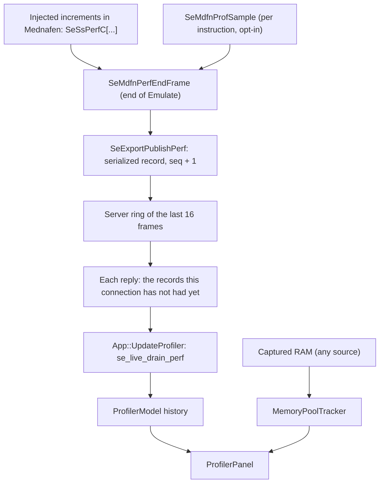

# Profiler

Inspected revision: the change that introduced it (protocol v26), on top of
`6491e73`. Behavior below is verified from source and from the tests listed; the
emulator-side numbers have **not** been checked against a running game (see Coverage limits).

## Purpose and responsibilities

The Profiler panel answers three questions about a running Saturn game, in the manner of a
console performance analyzer:

- **Where does each frame's time go?** Both SH-2s (busy / stalled on the bus / asleep /
  switched off), VDP1 drawing, the SCU DSP and the 68000.
- **What crosses the buses?** SH-2 external-bus accesses per device, grouped into the CPU
  bus, A-bus and B-bus, and SCU DMA traffic per level and per bus-to-bus route.
- **How full are the memory pools?** The fixed RAMs (work RAM high/low, VDP1/VDP2 VRAM,
  colour RAM, sound RAM): how much holds data and what is being rewritten.

Optionally it also attributes SH-2 time to **functions** (self time).

It owns the counters, their wire block and the panel. It does not own the shadow call stack
(it reads it; see [Debugger](Debugger.md)), function naming (`FunctionNames`) or the live
transport (see [State sources](StateSources.md)).

## Source locations, types and entry points

| Responsibility | Source and important symbols |
|---|---|
| Counter indices and the function key (single source of truth for emulator, wire and client) | [SePerfCounters.h](../../../Integration/Common/SePerfCounters.h): `SE_PERF_*`, `SE_PERF_DEV_*`, `SE_PERF_FN_*` |
| Emulator instrumentation | [apply.py](../../../Integration/Mednafen/apply.py): `PERF_DECL`, `PERF_BUS_HELPER`, the `*_PERF_*` / `SH2_*` anchors, `process_profiler`; `SsDbgCpuTimestamp`, `SsDbgSetProfileActive` in `SS_ACCESSORS` |
| Frame hand-over and function sampling | [se_mednafen_glue.c](../../../Integration/Mednafen/se_mednafen_glue.c): `SeSsPerfC`, `SeMdfnPerfEndFrame`, `SeMdfnProfSample`, `SeMdfnSetProfiler` |
| Server | [se_export.c](../../../Integration/Common/se_export.c): `SeExportPublishPerf`, `SeExportSetProfilerHook`, `SeExportCurrentFunction`, `SePublishProfiler`, the v26 trailing block |
| Wire contract | [SeLiveProtocol.h](../../../Integration/Common/SeLiveProtocol.h): `SE_LIVE_VERB_PROFILE`, `SE_LIVE_PROF_FUNCTIONS`, `SE_LIVE_CAP_PROFILER`, `SE_LIVE_CAP_PROF_FUNCTIONS`, "Perf block (v26+)" |
| Client | [LiveDriver.cpp](../../../Drivers/Live/src/LiveDriver.cpp): `LivePerf`, the v26 parse in `ReadSnapshot`; [LiveDriver.h](../../../Drivers/Live/src/LiveDriver.h): `se_live_perf_frame`, `se_live_drain_perf`, `se_live_set_profiler` |
| Model (UI-free) | [ProfilerModel.h](../../../FrontEnd/src/Debug/ProfilerModel.h): `PerfFrame`, `ComputePerfShares`, `ComputeBusTotals`, `ProfilerModel`, `MemoryPoolTracker` |
| Panel | [ProfilerPanel.cpp](../../../FrontEnd/src/ProfilerPanel.cpp): `ProfilerPanel::Draw`, `Host` |
| App glue | [App.cpp](../../../FrontEnd/src/App.cpp): `App::UpdateProfiler`, `App::DrawProfiler`; registered in `App::PanelList` (Windows → Debugger → Profiler, hidden by default) |

## Execution flow



### Counters (always on)

The patch adds one 64-bit array, `SeSsPerfC`, and increments it where the work happens:

| Counter | Where it is counted |
|---|---|
| Frame length, slave-on time | End of `Emulate()` (`end_ts`; the slave's timestamp reads `SS_EVENT_DISABLED_TS` while SMPC holds it off) |
| SH-2 sleep | The `SLEEP` op's idle step and `PSEUDO_STANDBY`, per CPU (`which`) |
| SH-2 bus stall | `PSEUDO_DMABURST` (DMA burst or external halt), per CPU |
| SH-2 bus accesses per device | `BSC_BusRead` / `BSC_BusWrite`, classified by a 64 KiB lookup table |
| VDP1 draw cycles / commands / starts / unfinished draws | `VDP1::Update`, the command fetch, `StartDrawing`, the frame-buffer-swap abort |
| SCU DSP cycles | The instruction loop of `SCU_UpdateDSP` |
| 68000 cycles (executed / total) | Around `SoundCPU.Run` in `SOUND_Update`; a slice that starts stopped or halted is not "executed" |
| SCU DMA transfers and bytes per level and route | `StartDMATransfer`, with the byte count the transfer was started with |

The increments are unconditional: each sits on a path that already does far more work.
Every hook is an insertion (never a replacement), so `apply.py --revert` restores the files.

`SeMdfnPerfEndFrame` runs from `SeMednafenEndFrameHook`, hands the array to
`SeExportPublishPerf` when a client is attached, and zeroes it. The server numbers each
frame (`seq`) and keeps the last 16; every reply carries the records its connection has not
been sent yet, oldest first (at most `SE_LIVE_PERF_MAX_PER_REPLY`). The records are a queue
beside the snapshot, not part of it: a client that is served a newer snapshot and skips one
still receives every frame's counters, and a paused or halted emulator sends none. The
driver additionally drops a `seq` it has already queued.

### Function attribution (opt-in)

`SE_LIVE_PROF_FUNCTIONS` (the `PRF` verb) makes `SeSyncCpuHook` keep the continuous
per-instruction callback installed, exactly as a tracepoint does. That selects Mednafen's
debug run loop, which is several times slower, so:

- the client sends it only while the panel is open with the checkbox ticked
  (`App::UpdateProfiler` restates the setting every frame; the driver sends changes);
- the server drops it when the client disconnects (`SeOnClientDisconnect`);
- it needs `--enable-debugger`; otherwise no hook is registered and the capability bit is
  clear, and the panel disables the checkbox.

Per instruction, `SeMdfnProfSample` charges the cycles since that CPU's previous
instruction, minus the sleep/stall cycles counted in between, to the function the previous
instruction was in. The function is the innermost shadow-call-stack frame's entry
(`SeExportCurrentFunction`); with no recorded frame (code already running when profiling
began, e.g. the main loop) the key is a 16-byte bucket of the raw PC, flagged
`SE_PERF_FN_RAW_PC`. A per-frame hash table collects the keys; the 64 hottest go on the
wire and the rest are summed into `fn_other_cycles`.

### Memory pools

Not an emulator feature: `MemoryPoolTracker` reads the captured regions through
`ContextBackend`, so it works for savestates and scrubbed frames too. Each pool is split
into at most 1024 blocks; a block that is one byte value repeated is *empty*, anything else
*holds data*, and a block whose hash differs from the previous sample is *rewritten* (the
mark fades over later samples). Sampling runs only while the Memory tab is showing, every
tenth UI frame. This is occupancy of the fixed RAMs, not a view of any game's heap
allocator, which the hardware knows nothing about.

## State, ownership and invalidation

- `SeSsPerfC` and the sampling table are written by the emulate thread only.
- `sPerfBlk` (the server's record ring) is guarded by `SE_LOCK`; `perfSent`, the newest
  frame a connection has been sent, is local to that connection's serving loop, so the
  local-socket and TCP clients each get every frame.
- The driver's perf queue is guarded by `ctlMtx`, bounded at 600 records, and cleared on a
  new connection; `perfSeqSeen` belongs to the poll thread.
- `ProfilerModel` is UI-thread state. It is cleared on `CloseData`, on
  `AdoptNewEmulatorInstance`, by the panel's Clear button, and by a `seq` that goes
  backwards (a new emulator run).

## Extension points and constraints

| Task | Start here; preserve |
|---|---|
| Add a counter | Append to `SePerfCounters.h` (never reorder), add the increment as an anchored insertion in `apply.py`, read it in `ComputePerfShares` / the panel. Older clients ignore surplus counters; older servers leave new ones zero |
| Add an emulator | Fill an array in `SePerfCounters.h` order and call `SeExportPublishPerf` once per frame; register `SeExportSetProfilerHook` only if a per-instruction hook exists |
| Change a record | Each states its own length: append fields, keep the existing order |
| Inclusive (caller) time, per-scanline timelines | Not implemented; see Coverage limits |

## Testing

```sh
ctest --test-dir build --output-on-failure -R 'ProfilerModel|ProfilerPanel|LiveProfiler|MednafenRoundTrip'
```

- [ProfilerModelTests.cpp](../../../FrontEnd/tests/ProfilerModelTests.cpp): share arithmetic
  and clamping, bus grouping, history window and de-duplication, function totals, pool
  classification.
- [ProfilerPanelTests.cpp](../../../FrontEnd/tests/ProfilerPanelTests.cpp): the panel drawn
  headlessly; drawn figures, tab-driven data requests, disabled attribution, row
  double-click through a row with a hoverable bar.
- [LiveProfilerTests.cpp](../../../FrontEnd/tests/LiveProfilerTests.cpp): real exporter and
  real driver; every frame once and intact, `PRF` reaching the emulate-thread hook, and
  attribution dropped on disconnect.
- [MemoryRoundTripTests.cpp](../../../FrontEnd/tests/MemoryRoundTripTests.cpp) (profiler
  section): the real glue; counters handed over and zeroed per frame, and
  `SeMdfnProfSample` charging cycles to a recorded function, to a raw-PC bucket, per CPU,
  less sleep, and not across a timestamp jump.
- The panel was also run in the native frontend against a stand-in emulator (the real
  export server fed synthetic counters) and inspected on all four tabs.

## Coverage limits

- The patched Mednafen 1.32.1 was **compiled and linked** with these hooks
  (`--enable-debugger`); it was not run with a game, so the magnitudes of the counters
  have not been compared with known workloads. Verify on a real title before relying on
  absolute numbers.
- "Busy" includes time an SH-2 spends waiting on slow bus cycles; only SLEEP/standby and
  DMA-burst/external-halt stalls are separated out.
- Bus accesses are the ones the emulator models as reaching the external bus: cache hits
  and fast-map instruction fetches are not counted.
- DMA bytes are the counts transfers were *started* with; an aborted transfer is counted
  in full.
- Function time is self time only, and the raw-PC buckets are not folded into functions
  (`ProfilerPanel::Host::functionContaining` is an unfilled hook for the function finder).
- VDP2 has no time figure: its raster is fixed-length.

## Related documentation

[Knowledge-base index](../README.md), [State sources](StateSources.md),
[Debugger](Debugger.md), [Mednafen integration](../../../Integration/Mednafen/README.md).
