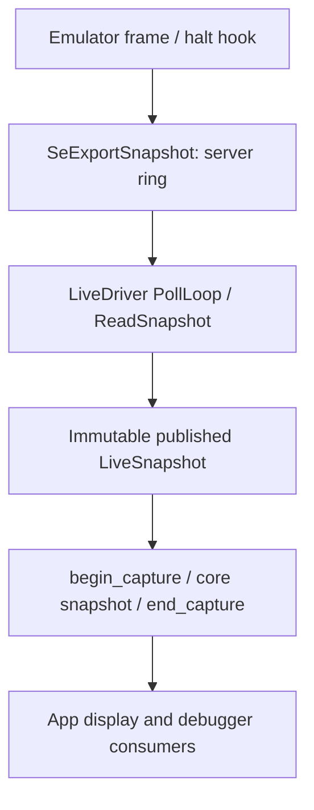

# State sources and emulator integration

Inspected revision: `ff6a3b1fb1c54e4c0344613094ea65292b0023c2` (2026-10-20).
Unless explicitly marked otherwise, behavior below is verified from source; tests were inspected, not executed for this document.

## Purpose and responsibilities

This subsystem supplies Saturn memory/registers to the analysis core, loads offline captures, and transports live execution controls and emulator events. Drivers expose the C callback table `se_data_source`; the core does not depend on an emulator's native types. The portable export server speaks to the live driver, while emulator-specific glue reaches private emulator storage and installs its hooks.

It does **not** own the frontend breakpoint model, recorded-frame browser, expression evaluation, or decompiler. Those consume its snapshots and queues.

## Source locations, types, and entry points

| Responsibility | Source and important symbols |
|---|---|
| Driver contract | [SeDataSource.h](../../../include/saturnexplorer/SeDataSource.h): `se_data_source`; [SeAbi.h](../../../include/saturnexplorer/SeAbi.h): ABI version/capabilities; [SeTypes.h](../../../include/saturnexplorer/SeTypes.h): register/region/status records |
| Offline formats | [SavestateDriver.cpp](../../../Drivers/Savestate/src/SavestateDriver.cpp): `Savestate`, `DispatchBuffer`, `ParseYssBuffer`, `ParseMednafenBuffer`, `ParseFullDumpBuffer`, `BuildDataSource`; [public factories](../../../Drivers/Savestate/src/SavestateDriver.h): `se_savestate_open`, `se_savestate_open_buffer`, `se_savestate_open_full_dump`, `se_savestate_open_region_dir` |
| Shared normalization | [SaturnStateShared.cpp](../../../Drivers/Common/src/SaturnStateShared.cpp): `sedrv::Bswap16`, `ParseSh2Regs`, `BuildVdp2RegImage`, `NormalizeCramToBigEndian` |
| Live client | [LiveDriver.cpp](../../../Drivers/Live/src/LiveDriver.cpp): `LiveState`, `LiveSnapshot`, `ThreadPin`, `PollLoop`, `ReadSnapshot`, `CurrentSnapshot`, `DisplayedSnapshot`, `EditTargetIsCurrent`; [LiveDriver.h](../../../Drivers/Live/src/LiveDriver.h): `se_live_open` and all `se_live_*` query/control APIs |
| Wire contract | [SeLiveProtocol.h](../../../Integration/Common/SeLiveProtocol.h): `SE_LIVE_VERSION`, `SE_LIVE_VERB_*`, `SE_LIVE_CAP_*`, section sizes and wire layouts |
| Export server | [se_export.c](../../../Integration/Common/se_export.c), [se_export.h](../../../Integration/Common/se_export.h): `SeExportInit`, `SeExportSnapshot`, `SeExportEndFrame`, `SeExportGateFrame`, `SeExportGateHalt`, `SeExportDeinit` |
| Mednafen adapter | [se_mednafen_glue.c](../../../Integration/Mednafen/se_mednafen_glue.c): `SeMednafenFrameHook`, `SeMednafenEndFrameHook`, `SeMednafenSnapshot`; [apply.py](../../../Integration/Mednafen/apply.py): generated emulator accessors/hooks |
| Yabause adapter | [apply.py](../../../Integration/Yabause/apply.py): patches emulator frame loop/debugger integration and copies the common server |
| App adoption | [App.cpp](../../../FrontEnd/src/App.cpp): `CreateContextFromSource`, `App::OpenSavestate`, `OpenSavestateBuffer`, `OpenFullDump`, `OpenLive`, `AttachLiveSource`, `CloseData`, `AdoptNewEmulatorInstance` |
| Emulator installation/launch | [install.py](../../../Integration/install.py) (Mednafen pinned via [UPSTREAM.json](../../../Integration/Mednafen/UPSTREAM.json)); [Launcher.cpp](../../../FrontEnd/src/Launcher.cpp): `BuildLaunchArgs`, `BuildLaunchArgv`, `Launcher::Validate`, `BundledMednafenPath` (a release's `mednafen-se/` beside the app, used when no path is recorded), `MednafenFirmwareDir` (also passed as `-filesys.path_firmware` by `App::LaunchSession`); release packaging in [DISTRIBUTION.md](../../../Integration/DISTRIBUTION.md); process/platform launch details are outside this document's traced scope |

## Execution flow

### Open an offline capture

1. `App::OpenSavestate` calls `se_savestate_open`. File and buffer factories converge at `DispatchBuffer`, which optionally gunzips input and selects `YSS` or `MDFNSVST` by magic. Unknown formats return `SE_ERR_UNSUPPORTED`.
2. `ParseYssBuffer` or `ParseMednafenBuffer` fills owned `Savestate` vectors and SH-2 records. `BuildDataSource` exposes callbacks/capabilities for the regions actually present. `HasAnyRegion` allows partial captures; VDP1 VRAM is not a universal prerequisite.
3. `CreateContextFromSource` calls `se_create`, then `se_begin_frame`. On creation failure it closes the newly opened driver. The app replaces its existing source only after the new context is created.
4. The core queries callbacks to build its own snapshot. Offline work-RAM edits update the driver's memory only; they do not rewrite the source savestate file (`BuildDataSource`, `CbWriteMainRam`).

Linear dumps use `ParseFullDumpBuffer` to extract fully contained hardware regions relative to a supplied bus base. Region directories recognize named files such as `vdp1_vram.bin`, `wram_low.bin`, and `vdp2_regs.bin`. Reuse these factories rather than teaching the frontend format layouts.

### Capture a live frame



`se_live_open` probes the endpoint, allocates `LiveState`, starts `PollLoop`, and returns a callback table. Defaults are a Windows named pipe or POSIX Unix socket; `tcp:host:port` is also supported. `PollLoop` establishes each connection with a plain GET before allowing version-gated mutations. `ReadSnapshot` checks magic, rejects versions below 3 or above the client's `SE_LIVE_VERSION` (25 at this revision), validates section lengths, and normalizes incoming regions.

The worker publishes an immutable `shared_ptr` snapshot under `LiveState::mtx`. `CbBeginCapture` pins it on the calling thread; all callbacks in that capture use one state even if another reply arrives. `CbEndCapture` retains the displayed snapshot in `gLastCaptured`. Stop and shadow-stack queries use `DisplayedSnapshot`, so debugger context agrees with memory on screen. Do not independently poll newest registers while evaluating displayed memory.

`PollLoop` also collects trace events, diagnostic logs, emulator slot inventory, keyboard mappings, and rewind blocks into separately synchronized queues/state. The frontend consumes them with `se_live_poll_events`, `se_live_poll_log`, `se_live_emu_slots`, `se_live_poll_keymap`, and `se_live_drain_state_blocks`. SH-2 registers and other memory are ordinary capture callbacks.

### Control, memory writes, and restore

Frontend calls queue requests under `ctlMtx`; the poll thread alone sends wire commands. `MinVerFor` is enforced at the single send point because an unknown payload-bearing verb can desynchronize an older server. `se_data_source` capabilities describe the driver's potential interface; live server version and `SE_LIVE_CAP_*` separately establish which emulator features really work.

On the server, the socket thread publishes requests; `SeApplyPendingInstalls` installs debugger changes on the emulator thread. `SeGateRelease` checks installs again before releasing a pause, preserving ordering between a temporary breakpoint and resume. Memory pokes pass through emulator write hooks rather than writing raw client buffers.

`CbLoadState` queues an LST payload containing an opaque full emulator state and optional edits. Server `SeGateDecide` applies loads only at a frame boundary. `SeExportGateHalt` releases an in-instruction halt when a load is pending, allowing the old frame to finish before restoration. `SeStateApplyLoad` loads, applies edits, adopts the requested frame, and calls `SeStateAfterRestore`, which clears stale wire frames/shadow stacks, rekeys state compression, and resumes execution. The successful restore counter advances when the first post-restore snapshot is published; acceptance of the request is not completion.

Rewind state capture is separate from picture capture: `SeExportSnapshot` stages a frame identity; `SeExportEndFrame` takes the actual savestate after frame bookkeeping. `SeStateWorkerBody` performs keyframe/delta compression off the emulator thread. `SeStateCodec.h` is the shared encoding contract. Rewind can be disabled using `se_live_set_rewind_enabled` so the emulator avoids full-state capture work.

## Interactions, ownership, and invalidation

- The core context owns the successful driver's lifetime: `se_destroy` ultimately invokes `se_data_source::close`. `CbClose` stops/joins the client worker and deletes its state. Avoid closing a copied callback table twice.
- `LiveState` owns the transport worker, immutable front snapshot, pending controls, and bounded queues. `ThreadPin` uses a monotonic instance ID, avoiding stale pins when an allocator reuses a deleted driver's address.
- Reconnect is automatic. `connGeneration` advances together with the new connection's first published snapshot. Consumers must invalidate per-emulator history using `se_live_captured_generation` **after capture**, rather than reconciling a generation sampled before capture (`LiveDriver.h`, `EditTargetIsCurrent`). Pending writes/loads/steps for a disconnected session are discarded.
- `se_live_captured_revision` changes only when snapshot content changes; `se_live_capture_unchanged` and `se_live_capture_pending` let the app avoid repeated multi-megabyte captures while paused. A derive serial alone does not prove new emulator content.
- Poke acceptance means queued, not confirmed applied. `se_live_poke_info` distinguishes emulator applied/dropped counts, definitely unsent client losses, and unconfirmed requests whose connection failed on the wire. Do not convert an unconfirmed outcome into a definite failure/success.
- Pending restores suspend pokes until the server's done+failed counts settle them. Old servers without those counters cannot establish completion; the driver keeps editing suspended until reconnection.
- `PollLoop` attempts bounded best-effort resume on close if it paused the emulator. Server `SeOnClientDisconnect` releases pad input, clears debugger installations/events and pause/step state, and permits the emulator to continue. `SeExportDeinit` stops server/compression workers and releases storage.

## Extension points and constraints

| Task | Start here; preserve |
|---|---|
| Support another offline format | Add parser/dispatch in `SavestateDriver.cpp`; populate `Savestate` and reuse `BuildDataSource`; add malformed/partial/endianness fixtures |
| Export another live region/status | Define wire layout/version gates in `SeLiveProtocol.h`, server serialization, emulator accessor/glue, client parsing and ABI callback only where needed; test actual availability rather than only driver capability bits |
| Add an emulator | Reuse `se_export.c` and hooks; implement emulator-specific state conversion and correct frame/halt sites; do not fork generic framing |
| Evaluate paused expressions | Consume capture-consistent memory/registers and displayed stop identity; preserve source-generation and restore invalidation; frontend/decompiler own expression semantics |
| Change rewind behavior | Follow capture → end-frame save → compression → queued blocks → frontend recorder → LST → frame-boundary restore → post-restore acknowledgement; keep epoch filtering and state-image opacity |

Memory returned by drivers is Saturn-order bytes. Metadata framing and individual wire structs have explicitly defined little-endian layouts; do not apply a blanket swap. Reuse `sedrv` normalization helpers. Mednafen CRAM RGB888 uses a special bus representation (`SsDbgCramWire` in the patcher), and CRAM/framebuffer pokes need dedicated accessors because its generic `CheatMemWrite` path cannot reach them.

`Integration/Mednafen/apply.py` is the maintained patch source; `_emu/mednafen` is generated/untracked. The adapter targets standalone Mednafen, not the Beetle libretro lifecycle. Real rewind requires functioning save/load accessors, frame gate, and build defines; compiling stubs is not evidence of a working integration. Read the integration README's rewind verification before changing those hooks.

## Testing

From `SaturnExplorer/`, configure/build as described in [BUILD.md](../../../BUILD.md), then use `ctest --test-dir build --output-on-failure` or focused filters:

```sh
ctest --test-dir build --output-on-failure -R 'SavestateShape|YssFixture|StateShared|LiveReconnect|LivePoke|LiveRestoreSignal|LiveExporter|LiveHaltRace|ExportAttach|ExportShutdown|ShadowCallStack'
```

Coverage locations:

- [SavestateShapeTests.cpp](../../../Drivers/Savestate/tests/SavestateShapeTests.cpp): malformed containers, gzip, host endianness, section bounds, partial captures and oversized input.
- [YssFixtureTests.cpp](../../../Drivers/Savestate/tests/YssFixtureTests.cpp): real Yabause fixtures; explicitly reports a skip if absent. Real Mednafen/Beetle, Yaba Sanshiro and Kronos fixtures remain absent according to this test; format confidence there includes synthetic coverage and layout analysis.
- [StateSharedTests.cpp](../../../Drivers/Common/tests/StateSharedTests.cpp): common byte/register conversion.
- [LiveReconnectTests.cpp](../../../FrontEnd/tests/LiveReconnectTests.cpp), [LivePokeTests.cpp](../../../FrontEnd/tests/LivePokeTests.cpp), [LiveRestoreSignalTests.cpp](../../../FrontEnd/tests/LiveRestoreSignalTests.cpp): actual client/core exchanges, reconnect/session protection, poke accounting, restore acknowledgement. [FakeLiveServer.h](../../../FrontEnd/tests/FakeLiveServer.h) supports controlled servers.
- [LiveExporterRobustnessTests.cpp](../../../FrontEnd/tests/LiveExporterRobustnessTests.cpp), [LiveHaltRaceTests.cpp](../../../FrontEnd/tests/LiveHaltRaceTests.cpp), [SeExportAttachTests.c](../../../Integration/Common/tests/SeExportAttachTests.c), [SeExportShutdownTests.c](../../../Integration/Common/tests/SeExportShutdownTests.c): portable server concurrency/lifecycle behavior.
- [ShadowCallStackTests.c](../../../Integration/tests/ShadowCallStackTests.c): recorded shadow-stack semantics. [Integration/tests](../../../Integration/tests/) also checks injected halt ordering, pad injection, VDP pokes and VDP1 latch behavior.

[CMakeLists.txt](../../../CMakeLists.txt) is authoritative for conditional availability: many real-socket integration tests require native POSIX/thread support. Synthetic tests do not prove hardware behavior in a running game. Real emulator verification commands and remaining manual gates live in the integration documents.

## Coverage limits and documentation discrepancies

The parser/client/server main paths and capture/restore ownership were traced. Every patch anchor and every wire-version transition was not individually audited; installation packaging, process spawning, and browser bridge deployment require their own implementation inspection for changes.

Two older descriptions disagree with this revision's code:

- `LiveDriver.h`'s opening comment calls the client native-only, and [BUILD.md](../../../BUILD.md)'s live section says web is savestate-only. CMake actually supports opt-in `SE_WEB_LIVE=ON` using pthreads and a WebSocket-to-TCP bridge; ordinary web builds still omit it.
- [Mednafen README](../../../Integration/Mednafen/README.md)'s hook-site overview describes init/deinit in `Load`/`CloseGame`. The maintained glue instead lazily initializes in `SeMednafenFrameHook`; it exposes `SeMednafenEndFrameHook`, and its lifecycle comment says explicit per-game shutdown would require an additional `CloseGame` hook. Treat current `apply.py`/glue as the implementation authority. A stale comment in `SeGateDecide` says restore leaves execution paused; `SeStateAfterRestore` actually clears `sPaused` and resumes.

## Related documentation

[Knowledge-base index](../README.md), [architecture](../ARCHITECTURE.md), [data flow](../DATA_FLOW.md), [Mednafen integration](../../../Integration/Mednafen/README.md), [Yabause integration](../../../Integration/Yabause/README.md), [installation](../../../Integration/INSTALL.md), [distribution contracts](../../../Integration/DISTRIBUTION.md).
