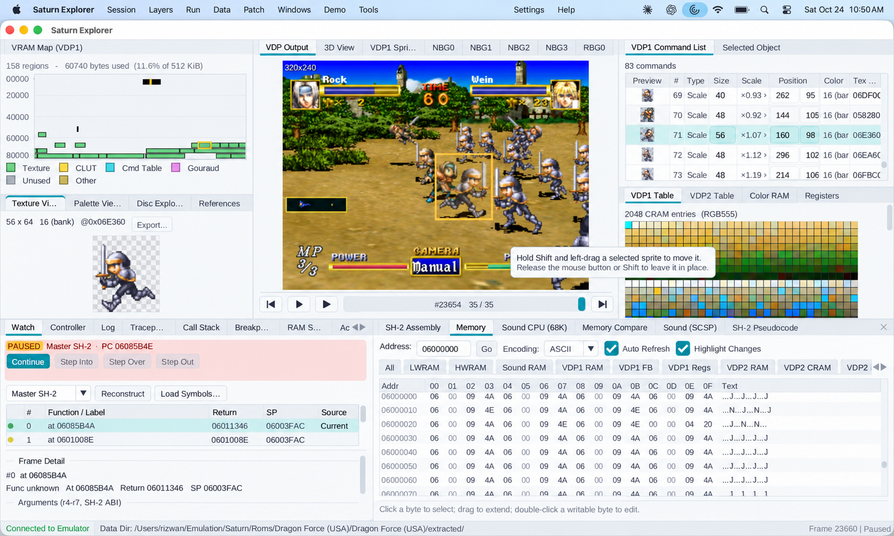
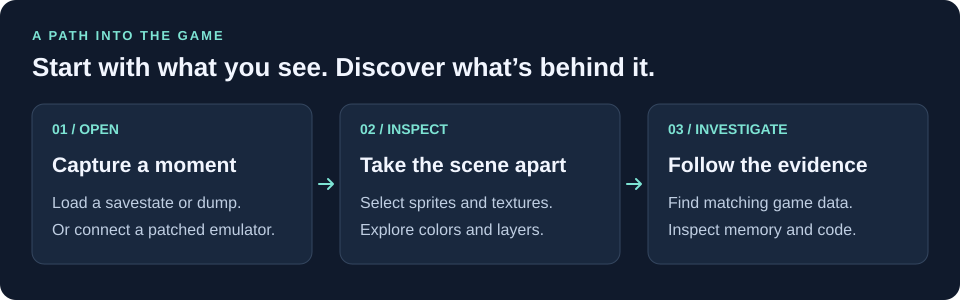

# Saturn Explorer

### See how a Sega Saturn game works, from the picture to the code.

Saturn Explorer lets you look inside Sega Saturn games. Open a saved game state or connect to a running emulator to explore the sprites, backgrounds, colors, memory, and instructions behind the screen.

Built for **fan translators, ROM hackers, and curious developers**, it helps answer questions like “Where is this character’s artwork stored?”, “How is this background drawn?”, and “What changes in memory when this happens?”

**[Download a release](https://github.com/NoahSteam/RomHackingTools/releases)** · **[Build from source](Docs/BUILD.md)**

*One scene, several ways to understand it. Here, a selected soldier connects the picture to its texture, drawing command, and location in video memory.*

## What can you do with it?

| You want to… | Saturn Explorer helps you… |
| --- | --- |
| **Find artwork** | Select an object in the reconstructed screen and inspect its texture, colors, and drawing command. Search game data for matching texture or palette bytes. |
| **Understand a scene** | Toggle background layers, inspect sprites, or explore the scene geometry in an exploded 3D view. |
| **Find changing values** | Inspect memory and watch addresses while the game runs, helping investigate dialogue, game logic, and other changing data. |
| **Follow the code** | Pause, set breakpoints, and step through the Saturn’s SH-2 processor instructions. Desktop builds also include C-like pseudocode to help read functions. |
| **Log without pausing** | Set tracepoints to record register or memory values whenever an instruction runs, while the game keeps playing. |

## From a game screen to an explanation

1. **Open a moment in the game.** Load a supported savestate or memory dump. On desktop, you can also connect to a patched Mednafen or Yabause emulator.
2. **Pick something to investigate.** Click a sprite in the reconstructed output to see the command that drew it. Inspect the texture and palette, or toggle backgrounds to see how the scene fits together.
3. **Follow the evidence.** Search for matching artwork in game data, inspect memory, or use live debugging to investigate the code behind what you see.

*A savestate is a snapshot of the emulated console at one moment. Live mode lets you inspect the game as it runs.*

## Get started

### Debug a running game on desktop

Get a desktop build from the **[releases page](https://github.com/NoahSteam/RomHackingTools/releases)** or follow the **[build guide](Docs/BUILD.md)** for Windows, macOS, or Linux.

Live debugging requires an emulator with the Saturn Explorer integration patch. The **[Windows installer](Integration/INSTALL.md)** can build the tool and a patched emulator for you. For manual setup, see the **[Mednafen](Integration/Mednafen/README.md)** or **[Yabause](Integration/Yabause/README.md)** integration instructions.

## Learn as you explore

You don’t need to know the Saturn’s hardware terminology to begin. These guides explain the chips and the panels used to inspect them:

- **[Sprites and textures (VDP1)](web/guides/vdp1.html)** — how the Saturn draws objects and how to inspect them.
- **[Backgrounds and layers (VDP2)](web/guides/vdp2.html)** — how scrolling layers and colors combine into a scene.
- **[Sound and music](web/guides/audio.html)** — the audio hardware and tracing sounds to game data.
- **[Reading SH-2 pseudocode](Docs/DECOMPILER_GUIDE.md)** — using the desktop decompiler.

For detailed setup and feature reference, see [ReadMe.txt](ReadMe.txt). For the implementation, start with the [codebase guide](Docs/Codebase/README.md).
